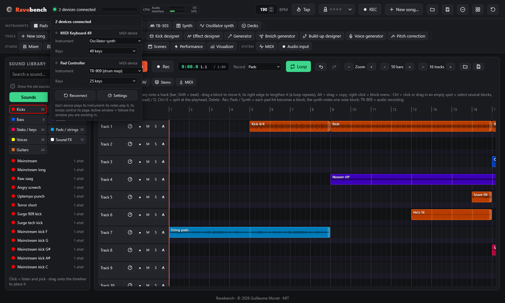

# The APC Key 25 controller

← [Getting started](getting-started.md) · [Contents](README.md) · [Pads and banks](pads.md) →

What each APC button does, the K1-K8 knobs and the performance effects.

## Controls on the APC

| Control | Action |
|---|---|
| **Pads** | Play the sound (the last pad hit becomes the selected pad) |
| **Shift + pad** | Select a pad without playing it |
| **SCENE LAUNCH 1-5** | Banks 1-5 · **Shift +** SCENE LAUNCH = banks 6-10, then 11-15, 16-20 and 21-25 on each new press (the LED blinks for banks 6-25; the screen shows the bank number) |
| **Track buttons 1 / 2 / 3 / 4** | Knob page: Synth / Effects / Selected pad / EQ |
| **Track buttons 5 / 6 / 7 / 8** (hold) | Roll 1/8 · Roll 1/16 · Roll 1/32 · Filter down |
| **Shift + track 5 / 6 / 7 / 8** | Roll 1/4 · Tape stop · Filter up · Pump (on/off) |
| **Shift + track 1 / 2 / 3 / 4** | Mixer knob page: volumes / pans / delay sends / reverb sends (K1 Pads, K2 Synth, K3 TR-909, K4 Timeline, K5 TB-303, K6 Decks, K7 Oscillator synth, K8 master) |
| **Knobs K1-K8** | Parameters of the current page, which follows the active window (Shift = fine tuning) |
| **SUSTAIN** | Opens / closes the EQ page (held: EQ while pressed) |
| **Shift + white key** | Preset of the current synth family (C = 1st, D = 2nd…) · **Shift + C# / D#** = previous / next family · **Shift + F# / G# / A#** = chord type / arpeggio on-off / arpeggio speed |
| **Keyboard** | Plays the synth of the active window (Synth or Oscillator synth) |
| **PLAY** | Start / stop the timeline (the TR-909 has its own ▶ in its window) |
| **Shift + PLAY** | Turn the pad grid into the TR-909 (and back) |
| **REC** | Record the chosen tool into the armed timeline track (and stop) · **Shift + REC** = TB-303 knob page, twice = turntables |
| **STOP ALL CLIPS** | Stops everything |
| **Shift + STOP ALL CLIPS** | Turn the pad grid into the 40 scenes (and back) |

**LEDs**: a loaded pad shows its colour, and a playing pad is fully lit or blinks. The mk1 only has three colours (red, green, yellow), so the colour picker shows those three when an mk1 is connected.

Everything can also be done with the mouse. On the computer keyboard, the middle row plays notes and **Z / X** change the octave.

## Knobs

There is no global knob window: **each instrument has its knobs in its own window** (synth, oscillator synth, pads window and pad editor, TR-909 under its grid, TB-303, turntables, kick designer, visualizer), and the mixer has a **Master** section (master EQ, global effects and volumes).

The 8 knobs of the APC (K1-K8) control one **page** at a time:
- the page **follows the active window**: click the TB-303 and K1-K8 control the TB-303, click the TR-909 and they control the selected 909 instrument, and so on (synth, oscillator synth, turntables, pad editor, mixer, visualizer);
- the devices indicator, top left, shows the current page ("1 device connected · Synth"); click it to open the device list, where the APC's **Knobs** menu lets you choose it;
- the APC track buttons also change it (1-4 = Synth / Effects / Pad / EQ, Shift + 1-4 = mixer pages, Shift + REC = TB-303 then turntables, Shift + PLAY = TR-909, SUSTAIN = EQ).

The group of knobs driven by the APC is outlined on screen and tagged "APC K1-K8". The pages:
- **Synth**: the 8 expression knobs of the current synth family (see Synth)
- **Effects**: delay time / feedback / send, reverb send / size, synth volume, pads volume, master volume (Master section of the mixer)
- **Pad**: volume, pitch, pan, filter, start point, delay and reverb sends, and playback mode of the selected pad (pad editor)
- **EQ**: low 100 Hz, low-mid 350 Hz, mid 1.2 kHz, high-mid 3.5 kHz, high 9 kHz (±15 dB), low-pass, high-pass, output gain (Master section of the mixer)
- **TR-909**, **TB-303**, **Decks**, **Oscillators** (see Oscillator synth), **Visualizer** (speed, hue, flashes, sensitivity, filters) and the four **mixer** pages.

Double-click a knob on screen to reset it.

## Connected devices

The indicator at the top left, next to the title, counts the connected devices: the APC Key 25 and the other MIDI devices (keyboards, controllers). Green dot: at least one device; orange dot: a problem (APC not found, port used by another app, MIDI access denied), with the details in the tooltip and in the list.

**Click it to open the device list**:
- a **LED** per device, which lights up when it sends something: touch a key or a knob to check that it responds;
- the **instrument** of each device: its notes play that instrument and its knobs control its page. On stage, each device has its own role:
  - **Active window** (default): as before, the device follows the window you are working in;
  - **Synth**, **Oscillator synth**: the notes play that synth (with chord mode and the arpeggiator), the knobs its page;
  - **Pads**: the notes trigger the pads of the current bank (C2 = pad 1), for a pad controller;
  - **TR-909**: the notes play the 909 instruments on the usual drum map (36 bass drum, 38 snare, 42 closed hat, 46 open hat…);
  - **TB-303**, **Decks**, **Mixer (volumes)**: the knobs control their page;
  - **Kick of the designer**: the notes play the designer kick, its tail tuned to the note;
  - **Nothing**: the device plays nothing (its learned controls stay active).
- for the APC following the active window, the **Knobs** menu chooses the page of K1-K8. Set to an instrument, the APC keeps its page when you change windows (its track buttons still change it);
- **Reconnect** closes and reopens the MIDI ports, without unplugging the cable: try it when a device stops responding;
- **Settings** opens the MIDI window (learned controls, MIDI clock, monitor).

The instruments are saved with the project, under each device's name: they come back the next time it is plugged in.

## Performance effects

- **Rolls** (beat repeat) lock to the grid: the repeat starts on the next 16th note.
- **Filter down / up** sweeps a low-pass or high-pass filter over one bar while you hold.
- **Tape stop** slows everything down to a halt.
- **Pump** ducks the synth on every beat.

## Other MIDI keyboards and MIDI learn

The APC Key 25 is not the only option: **any MIDI keyboard or controller** plugged in by USB (no driver needed for most of them) is recognised, alongside the APC. The **MIDI** window (plugin bar, System group) lists them.

- **Its keys** play the synth of the active window, like the APC keyboard (chords, arpeggiator and timeline recording included); **its sustain pedal** holds the notes.
- **MIDI learn**: in the MIDI window, click **Learn** next to a target, then move a knob or fader, or press a button on the device. Esc cancels; the bin removes an assignment.
- **Targets**: knobs **K1 to K8 of the active page** (exactly like the APC knobs: synth, effects, pads, mixer…), the **mixer faders**, the **master volume**, the **bus volumes**, and the transport: **play / stop**, **stop**, **record**, **loop**.
- A control drives only one target (assigning it again removes it from the old one). A key or pad assigned to a button no longer plays a note.
- **MIDI clock**: **Send to** a device (drum machine, sequencer, other software): it receives the clock (24 pulses per beat), Start, Stop and the position, and follows the timeline even when you jump to a marker. **Follow** a device: Ravebench takes its tempo and starts / stops with it.
- Assignments are saved with the project. At the bottom of the window, the **monitor** shows the last messages received from each device.

---

← [Getting started](getting-started.md) · [Contents](README.md) · [Pads and banks](pads.md) →
