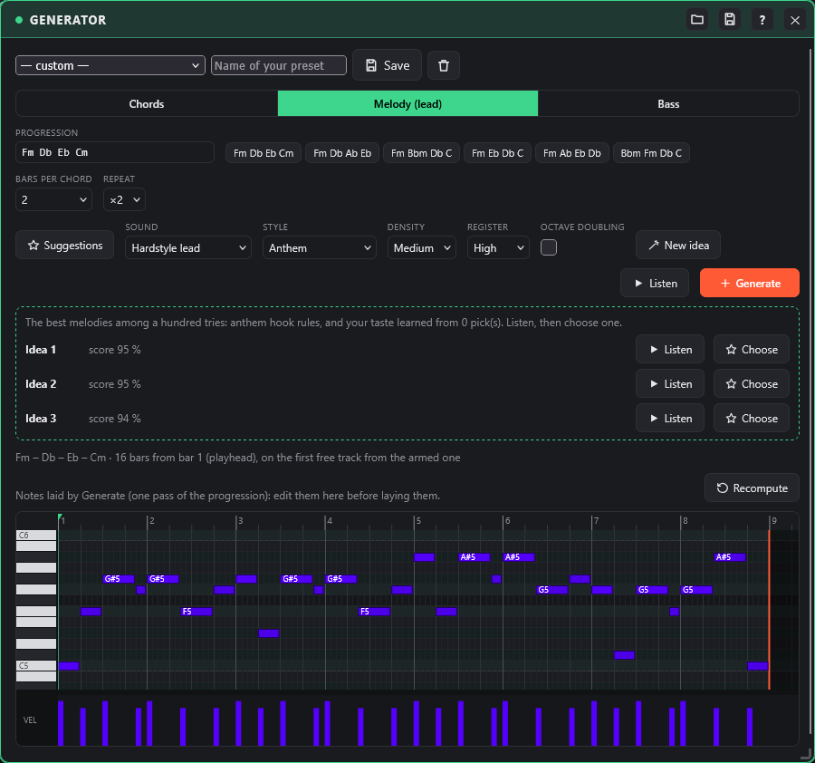
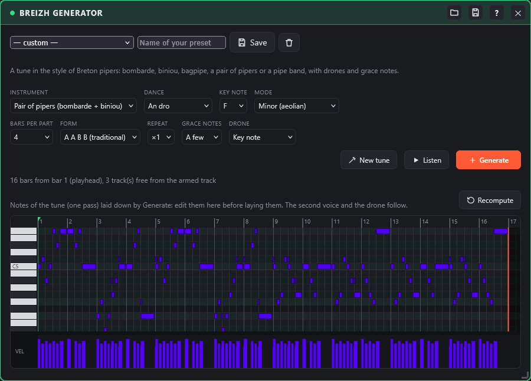
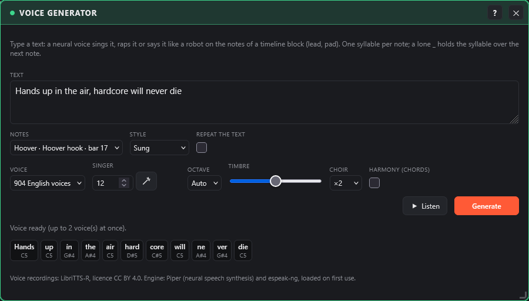
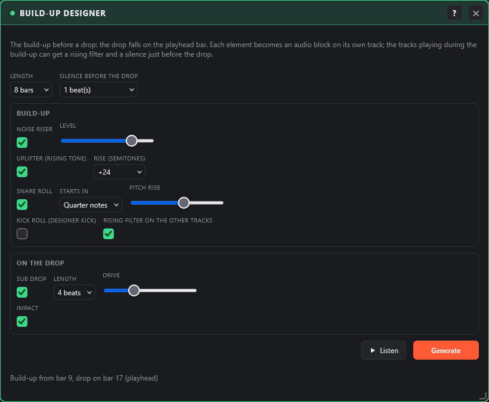

# Generator: chords, melody and bass

← [Instruments](instruments.md) · [Contents](README.md) · [Mixing and effects](mixing.md) →

The **Generator** window (plugin bar, Tools group) starts from a chord progression and lays on the timeline, in three tabs, **chord blocks** (strings, pads, choirs…), a **melody (lead)** or a **bass line** that follow those chords.

**Chords**

- **Progression**: type the chords separated by spaces or dashes (`Fm Db Eb Cm`, `Fm-Bbm-Db-C`…), or click a ready-made one. Recognised: major (`Db`), minor (`Fm`), `7`, `m7`, `maj7`, `sus2`, `sus4`, `dim`, `aug`, `5`, `add9`, with `#` / `b`.
- **Sound**: the current synth preset, or a preset from the strings, pads, choirs, supersaw, stabs or keys families. Each block keeps **its own preset**: you can play something else on the keyboard, or change preset, without changing the pads.
- **Register** (low, middle, high), **bars per chord** (1, 2 or 4), **repeat** (×1, ×2, ×4), **rhythm** (held, every beat, offbeat, 8th notes).
- **Bass**: none, sub (held), hardcore offbeat or reese (held), on the root of each chord, on a second track. For a real bass line, use the **Bass** tab.
- The chords follow each other with smooth **voice leading**: common notes are kept and the others move as little as possible.
- **▶ Listen** plays the first chord; **Generate** places the blocks from the playhead's bar, on the first track that is free for the whole length, starting from the armed track. The timeline grows if needed.

A chord block works like any other block: move it, lengthen it, copy it (Alt), open it in the piano roll (double-click) or delete it.

**Melody (lead)**

- Same **progression**, **bars per chord** and **repeat** as the Chords tab: the melody follows the harmony.
- **Style**: **Anthem** (a motif replayed on each chord, like a hardcore anthem hook), **Arpeggio**, **Hardcore riff** (short notes, octaves and fifths), **Call and response** (a phrase that rises, an answer that falls). Strong beats land on the chord notes; in between, the melody walks the scale (on a major chord in F minor, such as C, it takes E natural).
- **Sound** (supersaw, leads, hoovers, stabs or the current synth preset), **density** (sparse, medium, dense), **register** (middle, high), **octave doubling**.
- **New idea** draws another melody and plays it; **Listen** plays exactly what **Generate** will lay down (click again to stop).
- The melody is laid as **a single note block**, repeated over the whole length: double-click it to edit it note by note in the piano roll.

**Bass**

- Same **chord progression**, **bars per chord** and **repeats**: the line follows the harmony, with the root of each chord on its strong beats.
- **Style**, in the rhythms of the hardcore styles:
  - **Held sub**: the root held over the whole chord (anthem breaks, bass pads);
  - **Offbeat**: an 8th note between the beats, where the kick does not play (rave, early hardcore, frenchcore);
  - **Rolling**: three 16th notes between the beats (rave, hard trance);
  - **Reverse bass**: the two 16th notes after the offbeat, the "ta-ka" bass of hardstyle;
  - **Octaves**: 8th notes root / octave (happy hardcore);
  - **Walk**: root, fifth and octave in 8th notes, sometimes the third (rave);
  - **Acid**: TB-303-style 16th notes, with rests, octave jumps, accents and slides (with the Acid bass preset of the oscillator synth, overlapping notes glide).
- **Sound**: the basses of the synth (Bass, Reese, Sub) or those of the **oscillator synth** (Reese, Acid bass, Sub, Wobble), or the current preset. **Octave**: low (root between F1 and E2) or middle (one octave higher).
- **Passing note**: on the last offbeat of each chord, a note leading to the next chord (a semitone or a tone below or above its root, in the key).
- **Idea** draws another variation of the Walk and Acid styles and plays it. Like the melody, the bass is laid as **a single note block**, repeated, to edit in the piano roll.

**Editing the notes before laying them**

- Below the settings, a **piano roll** shows the **draft** of the displayed tab: the notes of one pass of the progression (the chords in the Chords tab, the melody in the Melody tab). Edit it like the [piano roll](timeline.md): click = add a note, drag = move, right edge = length, right-click = delete, Shift + drag = select; Ctrl+C / Ctrl+V / Delete / arrow keys when it has the focus.
- As long as the draft has not been edited, every setting recomputes it. Once **edited by hand**, the settings no longer change it: **Recompute** starts again from the settings (so does New idea, for the melody).
- **Listen** and **Generate** use the draft as shown. Chords are laid as one note block per chord (each keeps its name), the melody as a single block. The draft is saved with the project.

**Suggestions (no neural network)**

- **Suggestions** (Melody tab): the Generator tries about a hundred melodies on your progression and offers the **three best**, different from each other. The score comes from anthem hook rules: strong beats on the chord notes, mostly stepwise motion, few big leaps, a range of about an octave, a motif repeated from one chord to the next, a peak near the end of the phrase, an ending on the root.
- **Listen** to an idea, then **Choose** it: it becomes the melody draft. Each pick **learns your taste** (the average traits of the ideas you chose): later suggestions get closer and closer to it. The taste is saved with the project.
- **Suggest progressions** (Chords tab): anthem chord progressions in the key of your progression, built from the most common moves of minor-key hardcore and hardstyle (i, VI, VII, III, iv, v, V); click one to use it.

The **Generator**, **Breizh generator**, **Build-up designer**, **Voice generator** and **Pitch correction** have a preset bar like the instruments: set them up, type a name, **Save**; your settings (★) come back from the menu, the bin deletes them. They are saved with the project.

## Breizh generator

The **Breizh generator** window (Tools group) lays down a tune in the style of Breton pipers, played by Breton instruments, with its drone. It works like the Melody tab: a draft in the piano roll, **Listen**, **New tune**, **Generate**.

- **Instrument**: bombarde (double reed, loud and nasal), biniou kozh (small, very high Breton bagpipe), bagpipe, **pair of pipers** or **bagad**.
  - Pair: the bombarde and the biniou play together, the biniou an octave higher; the bombarde breathes at the end of each two-bar phrase while the biniou goes on.
  - Bagad: a section of bagpipes (nine pipers, each slightly out of tune), the bombarde section an octave lower.
  - The bagpipe and the bagad play in the chanter's own scale, tuned to the drones, measured on recordings of pipers: near-pure second, third, fourth, fifth and sixth, a very low G under the key note (the bagpipe's "flat" seventh), a slightly high top G. The bagad's bombardes stay in equal temperament.
- **Dance**: the rhythm of the tune.
  - **An dro**: steady eighth notes.
  - **Gavotte**: syncopated.
  - **March**: dotted rhythm.
  - **Gwerz**: slow air, long notes.
- **Key note** and **mode**: minor (aeolian), dorian, mixolydian (the bagpipe's mode) or major. For an anthem in F minor, choose F and minor (or dorian).
- **Form**: **A A B B** like a traditional tune (each part played twice, part B higher) or a single part **A**. Each part is a question that stops on the fifth, then an answer that comes back to the key note; the third bar takes up the motif of the first so the tune sticks.
- **Bars per part** (2 or 4) and **repeat**.
- **Grace notes**: very short notes just before the notes on the beat, the signature of pipers. For the bagpipe and the bagad, the high G of the chanter (high A on the high G), the pipers' most common grace note; for the bombarde and the biniou, the note above. **Many** adds them more often, sometimes two in a row.
- **Drone**: the key note held for the whole length (and the fifth with **Key note + fifth**), on its own track. Each drone note is a full set: two tenor drones almost in unison, beating slowly, and a bass drone an octave lower.

**Generate** lays one block per voice (melody, second voice, drone) from the playhead bar, on free tracks from the armed track. The draft shown is the melody: edit it, the second voice and the drone follow.

The sounds are also in the synth, family **Breizh**: bombarde, bombarde section, biniou kozh, bagpipe, pipe band (bagpipe section) and drone. They are synthesized, with no samples: reed waveforms, bell resonances, breath, and a pitch that moves a little like a real piper's. Their tone (waveform and resonances) was fitted on freely licensed recordings of bombardes, biniou, bagpipe chanter and drones. Level and tone move a little, like the pressure of a bag or a breath; the bagpipes link their notes without a break, the bombarde tongues them. In the sections (pipe band, bombardes), each player is slightly out of tune and starts a little apart from the others.

## Voice generator

The **Voice generator** window (Tools group) makes a neural voice sing a text, on the notes of a timeline block: the lead, the pad, a Generator melody.

1. Type the **text**.
2. Choose the **notes** block that gives the melody and rhythm. By default it is the selected block, otherwise the first lead. **None** (or a timeline without a note block): the voice is said in rhythm from the playhead bar, one syllable per 8th or 16th note (**Flow**), each beat stronger.
3. Choose the **voice** and the **style**.
4. **Listen**, then **Generate**: the voice becomes an audio block on a free track, lined up with the notes block. The leading consonants fall just before the note, as with a real singer.

The text is split into syllables, **one syllable per note**. If there are more syllables than notes, the notes pattern starts again; **Repeat the text** starts the text again until the last note of the block. A lone **_** between two words holds the previous syllable over the next note (it glides from one note to the other). After a render, each syllable is shown under the buttons with its note: check the placement, and change the notes in the piano roll if needed.

- **Style**:
  - **Sung**: each syllable takes the pitch of its note, the vowel holds the note, with a light vibrato on long notes and a bit of the voice's natural intonation.
  - **Rapped (MC)**: the voice keeps its spoken intonation, only the rhythm and placement follow the notes; for MC announcements and shouts. It goes through an **MC voice chain**, tuned on hardcore MC voices: shouted voice (it rises towards 230 Hz), presence and brightness, sharper attacks, saturation, compression, then an **echo** in time with the tempo (8th, dotted 8th or quarter, left / right) that fades under the voice and fills the gaps. **Punch** sets how much shout, saturation and compression (double-click: default).
  - **Robot**: the exact note, no vibrato or intonation.
  - **Vocoder**: the voice, said in the rhythm of the notes, modulates a synth (saw waves) playing the notes; with **Harmony**, the whole chord. The classic hardcore vocoder sound; hissing consonants stay audible.
- **Voice**:
  - French: Siwis (woman), Gilles (man), Jessica and Pierre, and a model with **125 French voices**;
  - English: LJ (woman), **904 English voices** and **109 British voices**.
  - In the models with several voices, pick the **singer** by number (or at random with the wand).
- **Octave**: **Auto** sings as close as possible to the voice's natural pitch (a man's voice doesn't sing a lead at its original octave); −2 to +2 shifts from the written notes.
- **Timbre**: to the right, a smaller, brighter voice; to the left, bigger and darker. Double-click: neutral.
- **Choir** (×2, ×4, ×8): the same line by several singers, slightly apart in time and tuning, spread in stereo.
- **Harmony (chords)**: on a chords block (a pad), one voice per note of the chord, from the highest to the lowest (up to 4), multiplied by the choir (8 voices at most).

How it works: the text is turned into phonemes (espeak-ng) and split into syllables. Each phrase (up to a rest between two notes) is said in one go by the neural voice (Piper), with a length set for each phoneme: the vowel of each syllable starts on its note, the onset consonants just before (like a singer), the vowel holds the note. The transitions between sounds stay natural. Then the pitch is moved note by note over the whole phrase (the same correction as the Pitch correction window: timbre kept, unvoiced consonants untouched). It remains a speaking voice that sings: a tuned-voice sound, closer to an MC than to a studio singer; very long vowels (over a second) get a more static timbre.

**Download**: nothing is loaded until the generator is used. On the first render, the browser downloads the engine (a few MB), the phoneme converter (18 MB) and the chosen voice (63 to 78 MB), then keeps them: the next times, the voice is ready in a few seconds. An Internet connection is needed the first time.

**Licences**: only voices whose licence allows any use, commercial included, are offered (CC0, CC BY, CC BY-SA, public domain). The licence and source of the chosen voice are shown at the bottom of the window; for CC BY and CC BY-SA, credit them in your track. The Piper engine and espeak-ng (GPL licence) are not part of Ravebench: they are downloaded from their public repositories.

The block is a recording like an audio take: saved with the project, named "Voice ·" with the start of the text, and filed in the Voice category of the library.

## Build-up designer

The **Build-up designer** window (Tools group) makes the build-up before a drop. Put the **playhead on the drop bar**, choose the elements, **Listen**, then **Generate**.

- **Length**: 2, 4, 8 or 16 bars before the drop.
- **Silence before the drop**: none, half a beat, one beat or two beats. The tracks playing during the build-up are cut just before the drop (a "Mute" effect block on each): the drop hits harder.
- **Build-up**:
  - **Noise riser**: filtered noise rising, with its **level**;
  - **Uplifter**: three detuned saws rising by 12, 24 or 36 semitones, the filter opening;
  - **Snare roll**: it starts in quarter, eighth or sixteenth notes and gets tighter every quarter of the build-up up to 32nd notes, with a crescendo and a **pitch rise** (0 to 12 semitones);
  - **Kick roll**: the same roll with the kick of the kick designer;
  - **Rising filter on the other tracks**: a "High-pass rise" effect block on each track playing during the build-up.
- **On the drop**: **Sub drop** (a sine falling from 90 to 30 Hz over 2, 4 or 8 beats, with its **drive**) and **Impact** (a thud and a falling noise).

Each element becomes an **audio block** on a free track, from the armed track: you can mix, move or delete it on its own. The sounds are saved with the project like takes. Everything is undone with Ctrl+Z.

---

← [Instruments](instruments.md) · [Contents](README.md) · [Mixing and effects](mixing.md) →
