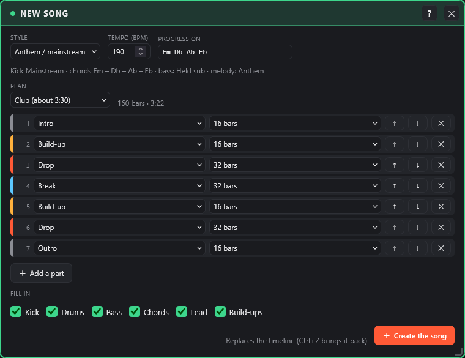
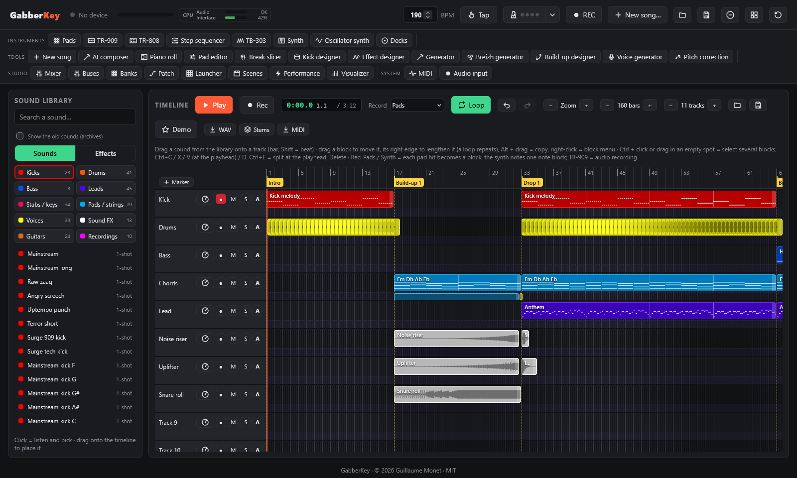
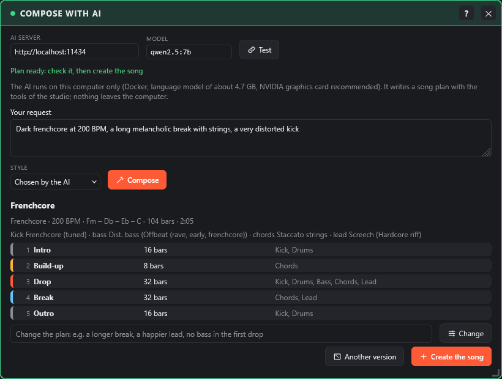

# Getting started

[Contents](README.md) · [The APC Key 25 controller](controller.md) →

What you need, installation, starting the app, a first song in seconds and the interface language.

## Requirements

- An **Akai APC Key 25**, mk1 or mk2. It is optional: everything also works with mouse and computer keyboard.
- **Google Chrome**, **Microsoft Edge** or **Firefox** (108 or later). Safari does not support Web MIDI.
- **Python 3**, only to serve the page locally (Web MIDI requires `localhost` or HTTPS).
- **WebGL** (in every recent browser) for the 3D modes and the filters of the visualizer; without it, the 2D modes still work.

## Installation

```bash
git clone https://github.com/guillaumemonet/gabber-apckey25.git
cd gabber-apckey25
```

Or download the ZIP from GitHub and unzip it.

## Starting

1. Plug in the APC Key 25.
2. Start the local server:
   - **Windows**: double-click `start.bat`.
   - **macOS / Linux**: run `./start.sh`.
   - **Anywhere**: run `python tools/serve.py`, then open http://localhost:8025.
3. In the browser, click **Start**, then **allow MIDI devices** when the browser asks.

The header shows **1 device connected** with a green dot once the controller is detected; click it to see the device list (APC Key 25 mk1 or mk2, other MIDI devices).

## New song: start from a style

**New song…** (header, or the plugin bar, Tools group) starts a song in a few seconds.

[](../screenshots/start-en.png)

1. **Style**: it sets the tempo, the chord progression, the kick (kick designer preset), the drum pattern, the bass line, the chord and lead sounds. The **tempo** and the **chord progression** can be changed before creating.

   | Style | Tempo | Kick | Bass | Melody |
   |---|---|---|---|---|
   | Early hardcore | 175 | Early | the kick | riff, early hoover |
   | Gabber (Rotterdam) | 185 | Rotterdam | the kick | riff, hoover |
   | Anthem / mainstream | 190 | Mainstream | held sub in breaks | anthem, hardstyle lead |
   | Frenchcore | 200 | Frenchcore | offbeat | riff, screech |
   | Uptempo | 210 | Uptempo | the kick | dense riff, screech |
   | Industrial | 160 | Industrial | the kick | sparse riff, alarm |
   | Terror | 240 | Terror | the kick | dense riff, screech |
   | Happy hardcore | 175 (major key) | 909 | octaves | dense anthem, supersaw |
   | Rave | 145 | 909 | walk (reese) | riff, mentasm |
   | Hardstyle | 150 | Raw | reverse bass | anthem, hardstyle lead |
   | Breizhcore | 190 | Mainstream | offbeat | the tune of the Breizh generator |

2. **Plan**: **Club** (intro 16, build-up 16, drop 32, break 32, build-up 16, drop 32, outro 16: about 3:30 at 190 BPM), **Short** (a sketch of about 1:20) or **DJ** (32-bar intro and outro, kick and drums only, for mixing). Each part (Intro, Build-up, Drop, Break, Outro) has its length (4 to 32 bars); ↑ / ↓ move it, ✕ removes it, **Add a part** adds one. The total length is shown.
3. **Fill in** (all ticked by default):
   - **Kick**: a kick melody (one kick per beat, on the roots of the chords) in the intro, drops and outro;
   - **Drums**: hats and claps from the "Anthem drums" or "Early hardcore" banks, a crash at the start of each drop;
   - **Bass**: the bass generator line in the drops (the anthem sub in the breaks); for the styles where the kick tail is the bass, the box is unticked: tick it to add an offbeat bass in the drops anyway;
   - **Chords**: build-ups, drops and breaks;
   - **Lead**: drops, and a sparser version in the breaks;
   - **Build-ups**: the **build-up designer** right before each drop (rising noise and tone, snare and kick rolls, sub drop, impact, rising filter on the other tracks, silence before the drop).
4. **Create the song** replaces the timeline (after a confirmation; **Ctrl+Z** brings it back in one go): one named track per element, one block per part, a **marker** at the start of each part. The **Generator**, the **kick designer** and the **keyboard synth** take the settings of the style: regenerate a melody or a bass line, change the kick, everything is then edited as usual.

[](../screenshots/start-song-en.png)

## AI composer (optional)

**AI composer** (plugin bar, Tools group) composes a song from a request in a few words, for example "dark frenchcore at 200 BPM, a long melancholic break with strings, a very distorted kick". A language model running **on your computer** writes a **song plan** with the tools of the studio: style, tempo, chord progression, kick settings, drums, bass, sounds, parts and what plays in each. Nothing is sent over the Internet.

[](../screenshots/ai-en.png)

### Installing the AI server

The AI server is a Docker container, installed once. GabberKey works without it: only this window needs it.

1. Install [Docker Desktop](https://www.docker.com/products/docker-desktop/). With an NVIDIA graphics card, also install its latest driver: Docker uses it directly.
2. In the GabberKey folder, run:

   ```
   docker compose -f ai/docker-compose.yml up -d
   ```

   The first start downloads the server (about 2 GB) and the model (`qwen2.5:7b`, about 4.7 GB, Apache 2.0 license). The server then restarts by itself with Docker.
3. Without an NVIDIA graphics card, the model runs on the processor, more slowly (one to two minutes per plan):

   ```
   docker compose -f ai/docker-compose.yml -f ai/docker-compose.cpu.yml up -d
   ```

With an 8 GB graphics card, a plan comes in 3 to 10 seconds (the very first request loads the model and takes longer). To stop the server: `docker compose -f ai/docker-compose.yml down`; to also delete the downloaded model, add `-v`.

### Composing

1. **AI server** and **Model**: `http://localhost:11434` and `qwen2.5:7b` by default. **Test** checks that the server answers and that the model is there. Another model of the Ollama library can be used: download it with `docker exec gabberkey-ai-ollama-1 ollama pull <model>`, then type its name.
2. **Your request**, a **Style** if you want to impose one, then **Compose**. The progress is shown; **Stop** gives up the request.
3. The plan is **checked** before it is shown: a value the studio does not know is replaced by the style's (the number is shown, the details on hover), a song with no drop gets one, and the bass does not play in the styles where the kick tail is the bass, unless the request wants one. The summary gives the style, tempo, chords, length, sounds and each part with what plays in it.
4. **Change**: describe the change in your words ("a longer break", "no bass in the first drop", "faster"); the AI sends back the changed plan. **Another version** asks for the same song again.
5. **Create the song** builds it like [New song](#new-song-start-from-a-style): the timeline is replaced (**Ctrl+Z** brings it back), the Generator, the kick designer and the keyboard synth take the settings of the plan.

The melody and the bass line are written by the generators of the studio, in the style and density chosen by the AI, and change with each version. The model is small: it may forget a build-up or misread a request. The plan is a starting point, edited like any other song.

## Language

The interface follows the browser language: French if the browser is set to French, English otherwise. To force a language, add `?lang=en` or `?lang=fr` to the address.

## Hardware compatibility

GabberKey is developed and tested with an **Akai APC Key 25 mk1**. The **mk2** is supported from Akai Professional's MIDI documentation, but has not been tested on a real unit yet. Everything also works with the mouse and the computer keyboard.

---

[Contents](README.md) · [The APC Key 25 controller](controller.md) →
