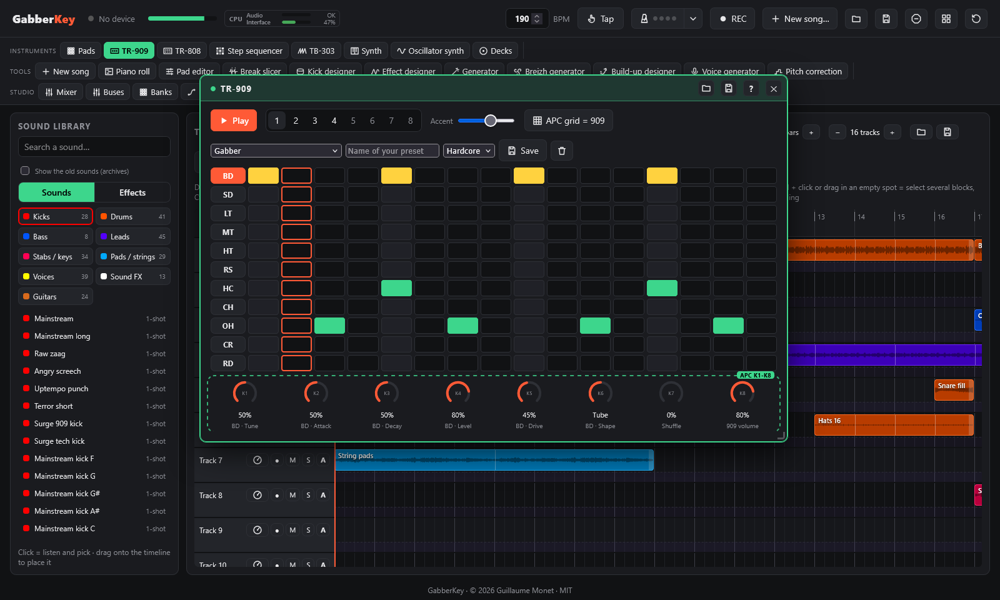
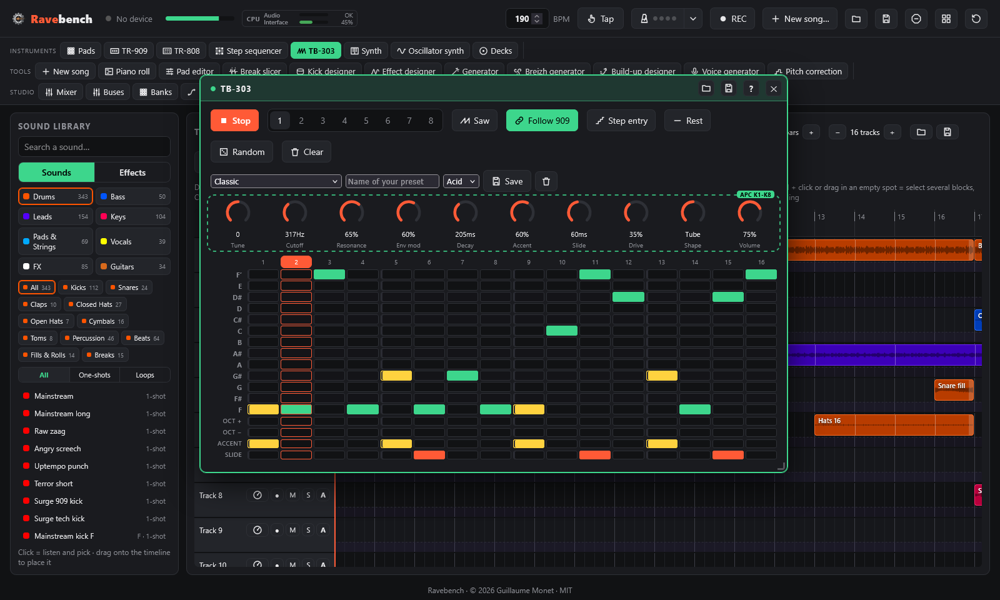
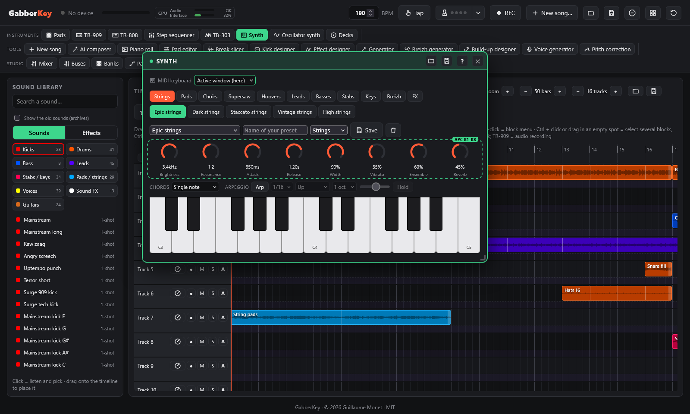
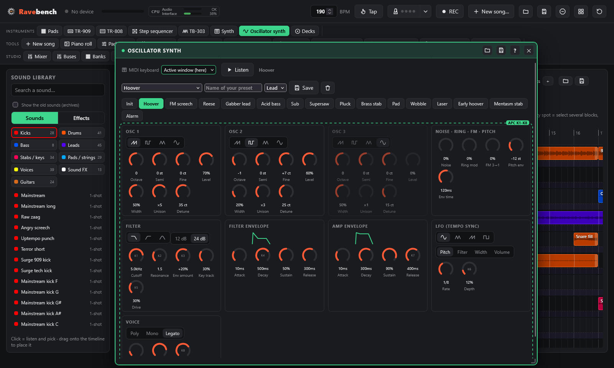
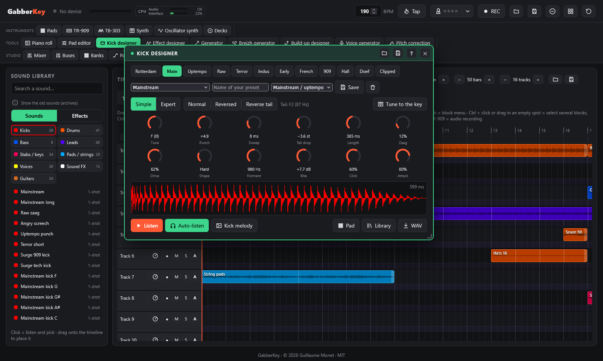
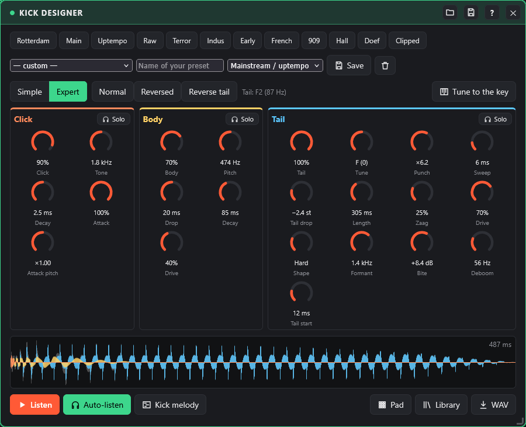

# Instruments

← [Timeline, library and piano roll](timeline.md) · [Contents](README.md) · [Generator: chords and melody](generator.md) →

TR-909, TB-303, layered synth, oscillator synth and kick designer.

## TR-909

A Roland TR-909 emulation with its 11 instruments (bass drum, snare, 3 toms, rim shot, clap, closed / open hi-hat, crash, ride). Each one is synthesised live, like the analogue circuits of the original.

**Knobs** (under the grid of the TR-909 window; also on the APC knobs when the window is active, or with Shift + PLAY):

| K1-K4 | K5 | K6 | K7 | K8 |
|---|---|---|---|---|
| Parameters of the selected instrument (e.g. BD: Tune, Attack, Decay, Level) | **Drive**: distortion amount | **Shape**: Soft, Hard, Tube, Fold (wavefolder), Crush (bitcrusher) | Shuffle | 909 volume |

Every instrument has its own distortion. The bass drum starts with a "Tube" drive for the gabber sound. The accent amount is set with the slider on screen.

**Sound kits** (menu above the grid): the settings of the 11 instruments at once, distortion included: **Hardcore** (Gabber, Rotterdam, Early hardcore, Doef, Clipped, Terror, Industrial), **Classic** (Clean 909, House, Techno) and **FX** (Lo-fi crush, Folded). Turning a knob makes the sound custom; type a name, choose a category and **Save** to keep your own (★ in the menu), the bin deletes it. The patterns are not part of a kit.

**Sequencer**: 16 steps, 8 patterns, 4 of them preset (gabber, rave, breakbeat, kick roll). It runs on the same tempo and bar grid as the loops, so it stays in sync with them. A pattern change waits for the next bar. On screen, click a step to cycle note → accent → off, and click an instrument name to play and select it.

**APC grid in 909 mode** (Shift + PLAY):

| Row | Pads |
|---|---|
| 1-2 | The 16 steps of the selected instrument (red = playhead, green = note, yellow = accent) |
| 3 | BD, SD, LT, MT, HT, RS, HC, CH: play and select |
| 4 | OH, CR, RD, then **Accent** (new steps are accented), **Clear** (erases the instrument), **Mute** |
| 5 | Patterns 1-8 |

Pressing a SCENE LAUNCH button brings the grid back to the sampler pads.

## TB-303

An acid bass line in the style of the Roland TB-303, synthesised live: oscillator (saw or square), resonant 24 dB low-pass filter driven by an envelope, accent, slide, then distortion with the 909's 5 shapes.

- **Grid**: 16 steps (16th notes) × one octave from F to high F. Click a cell to place a note, again for a rest. The **Oct + / Oct −** rows shift a step by an octave, **Accent** makes it louder with a snappier filter, **Slide** glides into the next note without retriggering the envelope (the famous "squelch").
- **Sound presets**: 18 ready-made sounds in 4 categories: **Acid** (classic, squelch, screamer, Rotterdam, early acid, hoover), **Bass** (rubber, sub, dark roller, doef bass), **Lead** (saw lead, squeal, gabber lead, alarm) and **FX** (laser, siren, crushed, zap). Turning a knob makes the sound custom; give it a name and a category and **Save** it to keep your own presets (★), saved with the session and in the TB-303 settings files.
- **Knobs**: tune, cutoff, resonance, envelope amount, decay, accent, **slide** (glide time between linked notes), drive, shape, volume. On the APC, **Shift + REC** opens the TB-303 knob page (K1 cutoff … K8 volume).
- **8 patterns**, 4 of them ready-made in F minor (acid gabber, rolling 16ths, squelchy slides, minimal offbeat). A pattern change waits for the next bar. **Random** writes a new acid line in F minor; **Clear** empties the pattern.
- **Follow 909** (on by default): the 303 plays on the TR-909's clock, shuffle included, and ▶ starts both. Turn it off to play the 303 on its own, on the loops' bar grid.
- **Step entry**: turn on **Step entry** and play the line on the APC keyboard (or the computer keyboard). Each note goes into the selected step and the cursor moves on; a strong hit adds an accent, **Rest** leaves a step empty, clicking a step number moves the cursor.
- The 303 has its own **mixer channel** (K5 on the mixer knob pages), is ducked by the **sidechain** with the melodic sounds, is stored in **scenes** (pattern and transport), and can be **recorded** into the timeline as audio (choose TB-303 as the source).

## Synth

The keyboard plays a layered synth built for hardcore: every preset stacks up to 3 **layers** of oscillators (saw, square, triangle, sine or pulse, each with its own unison, octave and level), with **formants** (string body resonance, "a" / "o" choir vowels), a stereo **ensemble**, unison spread across the stereo field, and a vibrato that comes in after a moment.

**46 presets in 11 families** (Synth window, or **Shift + white key** on the APC = preset of the family, **Shift + C# / D#** = previous / next family):

| Family | Presets |
|---|---|
| Strings | Epic, Dark, Staccato, Vintage, High |
| Pads | Arena, Dark, Warm, Glass, Sweep |
| Choirs | Rave, Ooh, Dark |
| Supersaw | Uplifting, Hardstyle lead, Pad, Stab |
| Hoovers | Hoover, Mentasm, Early hoover |
| Leads | Init, Acid 303, Screech, Horn, Gabber lead, Detuned lead, Alarm lead |
| Basses | Distorted, Reese, Sub |
| Stabs | Rave, Belgian, Orchestra hit, Hardcore stab |
| Keys | Rave piano, Organ |
| Breizh | Bombarde, Bombarde section, Biniou kozh, Bagpipe, Pipe band, Drone |
| FX | Tuned kick, Siren, Laser, Rave siren |

**8 expression knobs**, adapted to the family (in the Synth window and on the APC's Synth page):
- strings, pads, choirs, supersaw, stabs, keys: Brightness, Resonance, Attack, Release, **Width**, **Vibrato**, **Ensemble**, Reverb;
- hoovers, leads, basses, FX: Brightness, Resonance, Attack, Release, Drive, **Glide**, Detune, Reverb.

Double-click a knob in the Synth window to go back to the preset's value.

**Your presets**: the menu under the presets lists them all by family. Turning a knob makes the sound custom; type a name, choose a category and **Save** to keep your own (★ in the menu), the bin deletes it. A preset of yours keeps its starting sound and your 8 knobs.

### Chords and arpeggiator

Below the knobs of the Synth window:
- **Chords**: one key plays a whole chord: minor, major, sus2, sus4, minor 7th, fifth or octave. **In key (F minor)** builds the right chord of the scale on each key (F → Fm, G# → Ab, C# → Db, D# → Eb…), so everything stays in tune with the banks.
- **Arpeggio**: the held notes (or the chord) are played one after another, in time with the tempo and on the same grid as the loops. Speed 1/8, 1/16 or 1/32; order up, down, up-down, random or as played; range 1 to 3 octaves; note length; **Hold** keeps the arpeggio going after the keys are released (the next key starts a new one).
- On the APC: **Shift + F#** = next chord type, **Shift + G#** = arpeggio on / off, **Shift + A#** = arpeggio speed.

When the timeline records the synth, the chords and the arpeggio notes are recorded too, in the note block of the take.

## Oscillator synth

An analogue-style synth to build your own sounds, next to the layered synth.

- **Which synth the keyboard plays**: the APC keyboard (and the computer keyboard) plays the synth of the **active window**. Click the Oscillator synth window to play it, click the Synth window to go back ("Active window (here)" shows which one is played). Chord mode and arpeggiator work with both.
- **MIDI keyboard** (at the top of the Synth and Oscillator synth windows): **Active window**, or a connected device, which then plays this synth wherever you are (the same association as in the [device list](controller.md#connected-devices)). The synth's **on-screen keyboard** gets that device's number of keys (25, 32, 37, 49, 61, 76 or 88: guessed from its name, set in the device list); without a device, 25 keys.
- **3 oscillators**: saw, pulse (with its **width**), triangle or sine; octave, semitone, fine tune, level, **unison** (up to 7 detuned copies spread in stereo) and their detune.
- **Noise, ring modulation** (osc 1 × osc 2), **FM** (osc 3 modulates osc 1, for screeches and bells) and a **pitch envelope** (each note starts higher or lower and slides to its pitch: lasers, hoovers).
- **Filter**: low-pass, high-pass or band-pass, **12 or 24 dB**, cutoff, resonance, envelope amount (negative closes it), key tracking, drive before the filter.
- **Two ADSR envelopes** (filter and volume), drawn above their knobs.
- **Tempo-synced LFO**: sine, triangle, saw or square, from 1/1 to 1/32 with triplets, on the pitch, the filter, the pulse width or the volume.
- **Voice**: polyphonic (8 notes), mono or legato (no new attack between linked notes), glide, stereo width, volume.
- **15 presets**: hoover, FM screech, reese, gabber lead, acid bass, sub, supersaw, pluck, brass stab, pad, wobble, laser, early hoover, mentasm stab, alarm, as buttons and in a menu by category (**Lead**, **Bass**, **Pad**, **FX**). Turning a knob makes the sound custom; type a name, choose a category and **Save** to keep your own (★ in the menu), the bin deletes it.
- **APC knobs**: K1-K8 = cutoff, resonance, filter envelope, filter decay, drive, LFO depth, release, volume (marked on screen) while the window is active.
- It has its own **mixer channel** (K7 on the mixer pages), is wired in the **Patch** window and ducked by the **sidechain** like the synth. What you record on it becomes a note block with its sound, and in the **piano roll** any note block can use one of its presets.

## Kick designer

Build your own gabber / hardcore kick, computed by the browser in a few milliseconds. In **Simple** mode, 12 knobs:

- **Presets**: Rotterdam, Mainstream, Uptempo, Raw, Terror, Industrial, Early, Frenchcore, 909, Hall, Doef, Clipped 909 (buttons; the last three in the style of the mid-90s Rotterdam parties: a 909 pushed into distortion with a long booming tail, tuned to A#1, D#2 and F2), also in a menu by category (Gabber, Hardcore, Mainstream / uptempo) with your own kicks. Turning a knob makes the sound custom; type a name, choose a category and **Save** to keep your own (★ in the menu), the bin deletes it.
- **Direction** (next to Simple / Expert): **Normal**, **Reversed** (the whole kick backwards: it swells and ends on the attack) or **Reverse tail** (the hardstyle reverse kick: the tail backwards rising into the punch of the kick, to put on the offbeat). The direction is saved with the kick (your ★ kicks, kick melodies).
- **Tail**: **Tune** (note of the tail, in tune with the banks), **Punch** and **Sweep** (how high the pitch starts and how fast it drops), **Tail drop** (how far it keeps falling), **Length**, **Zaag** (sawtooth for the raw, buzzing tail of uptempo kicks).
- **Distortion**: **Drive** and **Shape** (the 909's 5 shapes), then **Formant** and **Bite**, which make the tail "talk".
- **Attack**: **Click** (noise) and **Attack** (short punchy layer).
- **Auto-listen** plays the kick each time you release a knob; the waveform and the length are shown.
- **→ Pad** puts it on the selected pad, **→ Library** adds it to the **Kicks** category of the library (drag it onto the timeline; right-click it there to remove it), **⤓ WAV** downloads it. Your kicks trigger the sidechain like any other kick.

### Expert mode: click, body and tail

The **Expert** button replaces the 12 knobs with the three layers of the kick, each set apart. The waveform shows each layer in its color. **Solo** on a layer plays it alone (**Play** and auto-listen); click again for the whole kick. Nothing is lost when switching modes: the 12 knobs of the simple mode are also in the layers, and the expert-only settings have a neutral value (a kick made in simple mode sounds the same).

- **Click**: **Click** (noise level), **Tone** (higher = thinner, sharper), **Decay**; **Attack** (the blip that drops very fast) and its **Attack pitch**.
- **Body**: a clean sine that dives down to an octave under the tail note, the "punch" you add under a heavily distorted tail. **Body** (level, off in the factory kicks), starting **Pitch**, **Drop**, **Decay**, **Drive**.
- **Tail**: **Tail** (level), the tail and distortion settings of the simple mode, and:
  - **Deboom**: cuts the low end of the tail under the chosen frequency, to leave room for the bass or a separate sub;
  - **Tail start**: the tail fades in, the click and the body make the attack alone.

### Tail note and kick melody

The tail note is shown above the knobs (for example "Tail: F2 (87 Hz)").

- **Tune to the key** tunes the tail to the key of the song: the root of the first chord of the **Generator**, the closest to the current note.
- **Kick melody** lays on the timeline a note block played by this kick, one kick per beat, and opens it in the **piano roll**. Each note retunes the tail: change the notes to make the kick sing, as in frenchcore or uptempo. If there is a chord progression in the Generator, the melody follows the root of each chord; otherwise it stays on the tail note.
  - Each kick cuts the previous one, and a short note gives a short tail.
  - The block follows the designer: each setting you change in the designer is heard at once in the melody. In the sound list of the piano roll, **Kick of the designer (current)** also turns any note block into a kick melody.
  - The same list offers the **designer presets** (Rotterdam, 909…) and **your saved kicks** (★): the block then keeps that kick, without following the designer. Several melodies can play different kicks this way. Saving a kick again updates the melodies that play it.
  - The kicks of the melody trigger the sidechain.

---

← [Timeline, library and piano roll](timeline.md) · [Contents](README.md) · [Generator: chords and melody](generator.md) →
