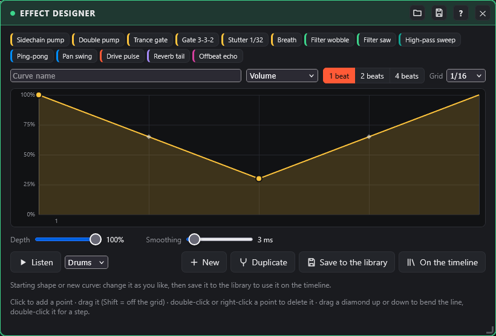
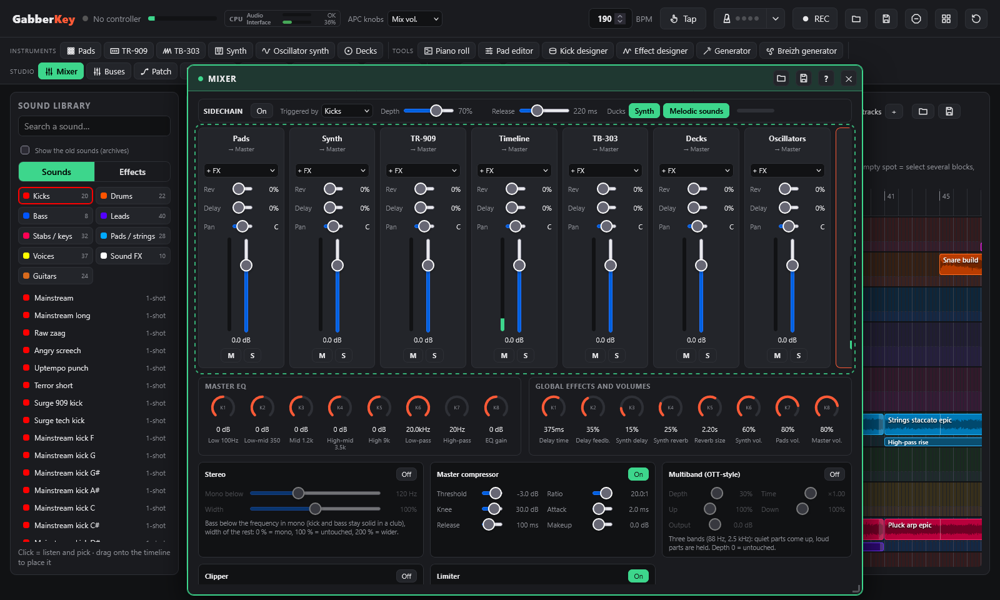
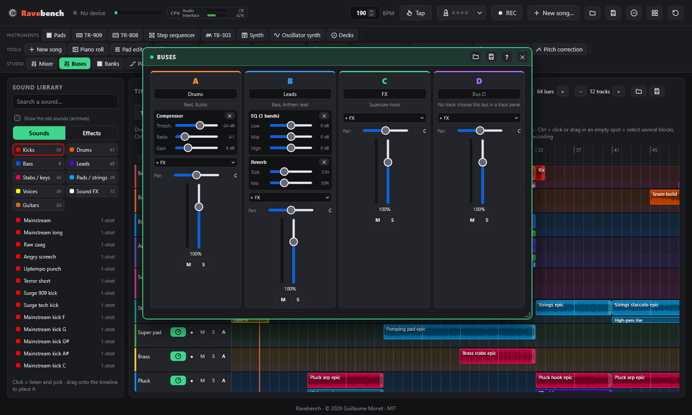
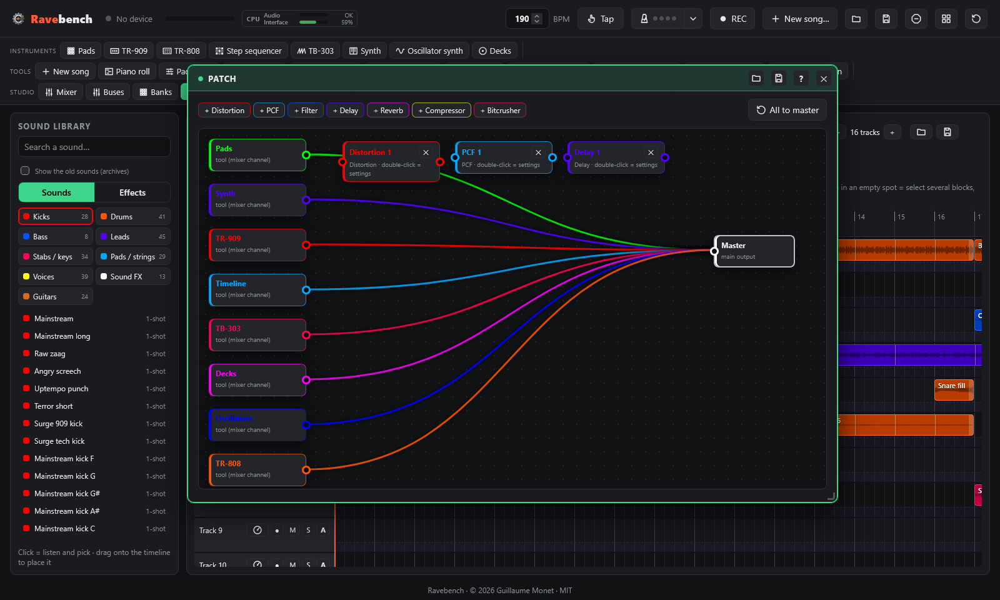

# Mixing and effects

← [Generator: chords and melody](generator.md) · [Contents](README.md) · [Live: turntables, scenes, visualizer](live.md) →

Effect designer, mixer and sidechain, patching effect boxes.

## Effect designer

Draw how a setting of a track moves over **1, 2 or 4 beats**: the shape repeats in a loop, locked to the tempo, for as long as its block lasts on the timeline (a sidechain pump made by hand, a trance gate, a filter wobble, a pan swing…).

- **Setting driven**: volume, low-pass filter, high-pass filter, pan, saturation, reverb send or delay send.
- **Editing**: click to add a point and drag it (snapped to the grid: 1/4, 1/8, 1/16, 1/32 and triplets; **Shift** = free), double-click or right-click a point to delete it. The **diamond** between two points bends the line (drag it up or down); double-click it for a **step**: the value holds until the next point.
- **Depth** brings the curve back towards "no effect" (shown dotted), **Smoothing** rounds off the steps so they never click. For the filters, the extreme cutoff and the resonance.
- **Listen** plays a library loop (drums, bass, strings or hoover) through the curve, with a playhead: every change is heard right away.
- **14 starting shapes**: sidechain pump, double pump, trance gate, 3-3-2 gate, stutter 1/32, breath, filter wobble, filter saw, high-pass sweep, ping-pong, pan swing, drive pulse, reverb tail, offbeat echo. Change one, then **Save to the library**: it becomes your curve.
- **On the timeline**: your curves are in the library, **Effects › Curves**. Drag one onto a track like any track effect, or click **On the timeline** (at the playhead, on the selected block's track). The block shows the shape. Changing your curve changes all its blocks at once, even while the song plays; double-click a curve block to open it in the designer.
- Your curves are saved with the project, travel inside song files and are in the WAV export and the stems.

## Mixer

One channel per tool: **Pads**, **Synth**, **TR-909**, **Timeline**, **TB-303**, **Decks** and **Oscillator synth**, then the master (performance effects, master EQ and limiter). The level of each sound stays in its tool (pad volume, 909 instrument levels); the mixer balances the tools.

Each channel has insert effects (**+ FX**, up to 4, applied in order), reverb and delay sends, pan, a fader (0 dB at three quarters), **M**ute, **S**olo and a meter. Available effects:
- **Distortion**: drive and the 5 shapes of the 909.
- **Filter**: low-pass or high-pass, cutoff and resonance.
- **Compressor**: threshold, ratio and gain.
- **Reverb**: size and mix.
- **EQ (3 bands)**: low, mid and high.
- **Multiband (OTT)**, **Clipper** and **Stereo (mono bass)**: the same as in the master chain (see below), with the same settings. A clipper on the kick bus or on the kick track gives a louder kick without touching the rest; a stereo at 0 % width makes a track mono.

Double-click a control to reset it. On the APC, **Shift + track button 1 / 2 / 3 / 4** turns the knobs into the mixer's volumes / pans / delay sends / reverb sends: K1 = Pads, K2 = Synth, K3 = TR-909, K4 = Timeline, K5 = TB-303, K6 = Decks, K7 = Oscillator synth, K8 = master volume. The mixer settings are saved and included in session exports.

### Sidechain

At the top of the mixer window. When it is **On**, every kick ducks the **synth** and the **oscillator synth** (keyboard, note and chord blocks), the **TB-303** and the **melodic sounds** (pads and timeline blocks in the Bass, Leads, Stabs / keys, Pads / strings and Voices categories), which then come back up smoothly: the track breathes with the kick. Kicks and drums are never ducked.

- **Triggered by**:
  - **Kicks**: the TR-909 bass drum, the kick pads and blocks, and the kicks of the GabberKey loops (their exact positions are stored in the library: a gallop, a roll or a build-up ducks on each of its kicks). A recording of the 909 in the timeline keeps the position of its kicks too.
  - **Every beat**: on each beat of the grid, for loops whose kicks are unknown (Sonic Pi loops, your own loops).
- **Depth** (how far the sound goes down) and **Release** (how long it takes to come back up); double-click to reset.
- **Ducks**: choose the synth, the melodic sounds, or both. The meter shows the ducking in real time.
- The ducking is scheduled at the exact time of each kick (on the audio clock), not detected afterwards: no delay, and it stays in time at any tempo.

### Buses

The **Buses** window (plugin bar, Studio group) groups tracks of the timeline so you can process them together: all the drums through one compressor, all the leads through one reverb…

- **Send a track to a bus**: in the track's panel (dial button in its header), choose the **Bus** (A to D). The bus letter shows in the track header, and the bus lists its tracks.
- Each bus has a **name**, up to 4 **insert effects** (EQ, compressor, distortion, filter, reverb, multiband, clipper, stereo), **pan**, **volume** and a meter; double-click a setting to reset it.
- **M** mutes every track of the bus, **S** solos it: only its tracks are heard (with the soloed tracks).
- A bus keeps sending each sound where its tracks sent it (synth, pads, sidechain path…): putting a track in a bus changes neither its level nor its sidechain, it only adds the bus processing.
- Sending a track to a bus can be undone with Ctrl+Z; buses are saved with the project and in song files, and the WAV export goes through them.

### Master chain and loudness

Below the mixer channels, the **master chain** processes everything that goes out, in this order:

- **Stereo**: puts the **bass in mono** and sets the **width** of the rest. In a club, the sound system is often mono in the low end: a slightly stereo kick or bass loses power there, and the compressors react better to the same low end on both channels. **Off by default.**
  - **Mono below** (20 to 300 Hz, 120 Hz by default): below this frequency the sound becomes mono (24 dB per octave slope). Above it, the stereo image does not move.
  - **Width** (0 to 200 %, 100 % by default): 0 % = all mono, 100 % = original width, 200 % = wider. Beyond about 130 %, keep an eye on the **phase**.
- **Master compressor**: threshold, ratio, knee, attack, release, makeup. Its starting settings are those of GabberKey's old limiter: an existing song sounds exactly the same. Lower the ratio (2 to 4) and raise the threshold for a gentler "glue" compressor.
- **Multiband (OTT-style)**: OTT-style multiband compression, the "everything loud and detailed" sound of hardcore and hardstyle. The sound is split into three bands (below 88 Hz, 88 Hz to 2.5 kHz, above 2.5 kHz); in each band, the parts above a threshold are pushed down and the quiet parts below another threshold are brought up (tails, reverbs, details), then the processed bands are blended with the untouched ones. **Off by default.**
  - **Depth** (0 to 100 %, 30 % when you turn it on): how much of the processed sound is blended in. At 0 % the sound passes untouched.
  - **Time** (×0.10 to ×5): scales the attack and release of the three bands together (shorter = more aggressive, longer = smoother).
  - **Up** / **Down** (0 to 100 %): how much upward and downward compression is applied. Down at 0 % = it only brings up the quiet parts.
  - **Output** (−12 to +12 dB): level after the multiband.
  - Very quiet sound (below about −70 dB: noise, silence) is never brought up.
- **Clipper**: shaves the peaks at the **ceiling**, before the limiter. A kick's peaks are very short: cutting them costs little to the ear and leaves the limiter much less to do, so the song gets louder and cleaner than by pushing the limiter alone. The clipping is computed at 4× the sample rate (less aliasing). **Off by default.**
  - **Drive** (0 to +12 dB, +3 dB by default): pushes the sound into the ceiling.
  - **Ceiling** (−12 to 0 dB, −0.5 dB by default): no peak goes beyond it.
  - **Softness** (0 to 100 %, 30 % by default): 0 % = hard clipping (cleanest on a kick), 100 % = round saturation that starts well below the ceiling.
  - Order: the multiband comes before the clipper (it shapes the bands, then the clipper shaves what sticks out), and the limiter last only catches what is left.
- **Limiter**: it looks 5 ms ahead so that **no sample goes over the ceiling** (−0.3 dB by default), without clipping. **Input gain** pushes the sound against the ceiling: it is the setting that makes the song louder. **Release**: how fast the gain comes back after a peak (longer = smoother, shorter = louder but more "pumping").
- **Loudness**: measured in **LUFS** (EBU R128), as streaming platforms do. **Momentary** (400 ms), **short term** (3 s), **integrated** (since the last **reset**), **peak** and the limiter's **gain reduction**. The bar shows the short-term loudness; the green zone is the target.
- **Phase**: the correlation between the two channels. +1 = mono, around +0.5 = a wide, healthy stereo, 0 = two unrelated channels; **below 0 (in red)**, parts of the sound cancel out when played in mono (club sound system, phone). Then lower the width or look for the effect that is too wide.
- **Target for hardcore**: about **−8 to −6 LUFS integrated**, peak at the ceiling. Raise the limiter input gain until you reach the zone, keeping an eye on the gain reduction: beyond 6 to 8 dB of constant reduction, the sound gets squashed. To go further cleanly, turn on the clipper (drive 3 to 6 dB) and let the limiter catch only a few dB; add some multiband (Depth 20 to 40 %) for density.
- Each **On / Off** button bypasses its stage; double-click a setting to reset it. The chain is saved with the project and in the mixer settings file, and the **WAV export** goes through it.

## Patch

The **Patch** window wires the tools and **effect boxes** freely, like a rack of hardware. By default every tool goes straight to the master: nothing changes until you touch it.

- On the left, one block per **tool**: pads, synth, TR-909, timeline, TB-303, turntables, oscillator synth. Each tool keeps its **mixer channel** (volume, pan, mute, solo, insert effects, sends); the patch decides where that channel goes. On the right, the **Master**.
- **Effect boxes**: **Distortion** (drive, the 909's 5 shapes, tone, mix), **PCF** (rhythmic LP / BP filter restarted by a 16-step pattern, always on the tempo grid), **Filter** (LP, HP or BP with a tempo-synced LFO), **Delay** (in note values: 1/4, 1/8, dotted 1/8, 1/16, quarter-note triplet), **Reverb**, **Compressor**, **Bitcrusher**. Double-click a box for its settings, ✕ removes it.
- **Wire**: drag from an output (right-hand socket) onto a box or the master. An output can feed several destinations, a box can receive several sources, and boxes can be chained. A cable that would create a loop is refused. **Click a cable** to unplug it. A tool that goes nowhere is silent: the mixer shows where each channel goes, under its name.
- **All to master** wires every tool straight to the master again. The fast WAV export and the stems rebuild exactly the same wiring.

---

← [Generator: chords and melody](generator.md) · [Contents](README.md) · [Live: turntables, scenes, visualizer](live.md) →
