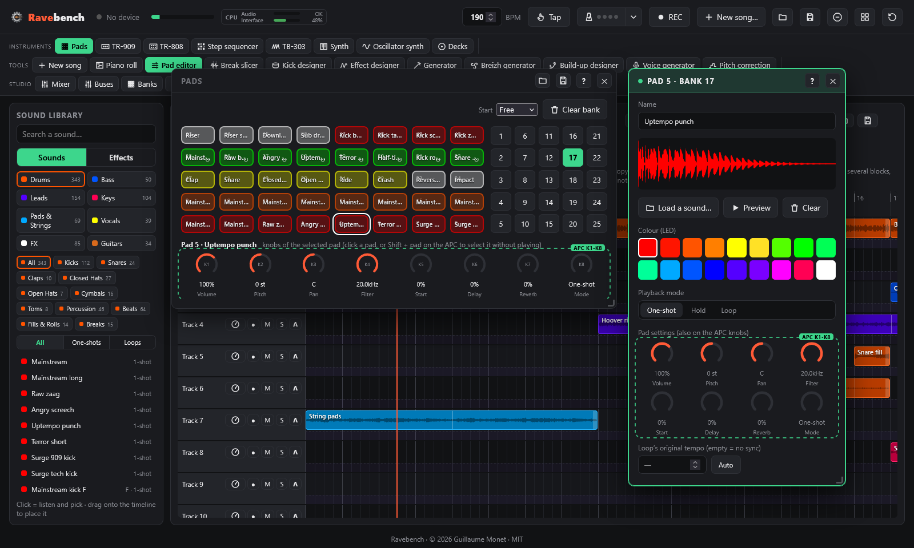
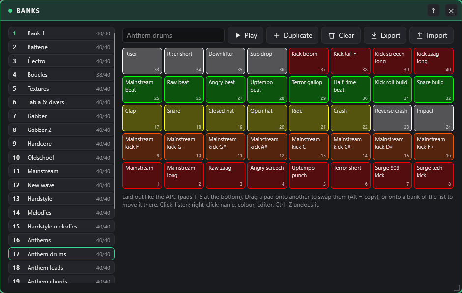
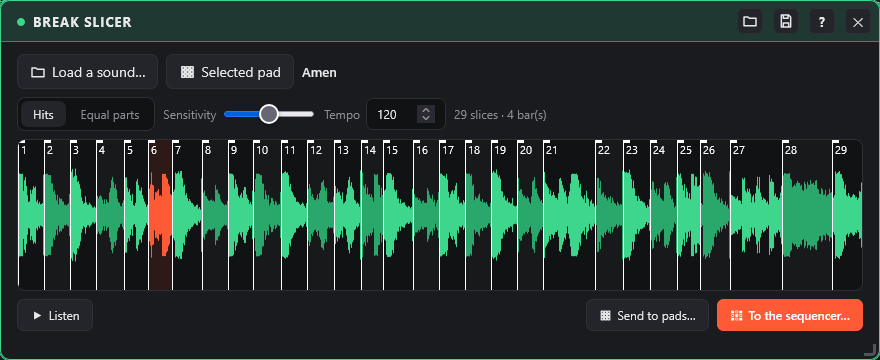

# Pads and banks

← [The APC Key 25 controller](controller.md) · [Contents](README.md) · [Timeline, library and piano roll](timeline.md) →

The 40-pad sampler, the 25 banks, loops locked to the tempo, the break slicer.

## Banks

| Bank | Content |
|---|---|
| 1 | Starter kit, synthesised in the browser |
| 2 | Drums |
| 3 | Electro |
| 4 | Loops (22 loops at 120 BPM) |
| 5 | Textures & basses |
| 6 | Tabla & misc. |
| 7 | **Gabber**: 8 kicks (Rotterdam, Early, Terror, Industrial, Frenchcore, Reverse…), percussion, hoovers, stabs, screeches, loops at 190 BPM |
| 8 | **Gabber 2**: darker "doomcore" kicks tuned from C to G, FX (riser, downlifter, laser, impact…), 16 loops (frenchcore, half-time, doomcore beat, kick triplets, second hoover, stab and acid riffs, snare build…), rave stabs |
| 9 | **Hardcore**: harder kicks (terror, uptempo, speedcore, industrial, mainstream…), distorted basses, string chords (Fm, Db, Eb, Cm, Bbm, Ab), staccato and orchestra hit, string / bass loops (ostinato, progression, offbeat, rolling, reese, 4-bar full track) and hardcore drum loops, all at 190 BPM |
| 10 | **Oldschool** (early 90s rave / hardcore): 909 and 808 kicks, breakbeat kit, rave pianos (Fm, Db, Eb, Cm, Bbm, Ab), Mentasm and Belgian stabs, "ahh" choir, vox stab, whistle, air-raid siren, Amen-style and chopped breaks, piano riff, rave arp, 4-bar oldschool track, all at 190 BPM |
| 11 | **Mainstream** (dark mainstream hardcore, F harmonic minor): kicks with a distorted tonal tail (angry, dark, punchy, pitch drop, raw, tuned C# and G#), hard clap and percussion, dark and screaming leads, screeches, dark hoover, horror bells, dark piano, synthesised shouts ("hey", "oi", "yeah"), dark choir and strings, horror pad, loops (beat, lead riff, screech riff, bell melody, breakdown pad, build-up, 4-bar full track), all at 190 BPM |
| 12 | **New wave** (modern hardcore / uptempo): kicks with long raw "zaag" tails (zaag, raw, screech kick, hard punch, tok, kick-bass), 8 tuned kicks (F to F) for kick melodies, supersaw lead and chords (Fm, Db, Ab, Eb), pluck, pitch lead, euphoric pad, shouts, uplifter, tunnel, glitch, loops (uptempo beat, kick-bass, kick melody, gallop, supersaw chords, pluck melody, build-up, 4-bar drop), all at 190 BPM |
| 13 | **Hardstyle** (hardstyle / rawstyle, **150 BPM**): hardstyle, raw, screech, euphoric, zaag and punch kicks, tuned kicks C# and G#, **reverse basses** (F, C#, D#, G#), big clap, china crash, raw screeches, euphoric lead and chord, pluck, pitch lead, raw stab and hoover, shouts ("hey", "raw", "go"), pitch riser, uplifter, deep sub drop, impact, air horn, loops (hardstyle beat, the offbeat **reverse bass** groove, reverse bass over a chord progression, rawstyle loop, kick build-up, screech riff, euphoric melody, 4-bar drop) |
| 14 | **Melodies** (hardcore / gabber, 190 BPM, F minor): 40 melodic loops with no drums, to layer on any beat: themes (hoover, screech, horn, dark lead, mentasm, acid), emotional themes (piano, strings, staccato, bells, choir, pluck, supersaw), 2-bar hooks, chord / arpeggio / bass-line loops, and 8 full themes (melody + chords + bass) over the classic progressions Fm–Db–Eb–Cm, Fm–Db–Ab–Eb, Fm–Bbm–Db–C and Fm–Eb–Db–C |
| 15 | **Hardstyle melodies** (150 BPM): 40 loops: euphoric supersaw leads, raw screech melodies, raw leads and hoover, plucks, piano and bells intros, choir and strings, euphoric chords, reverse-bass lines, and 8 full anthems (lead + chords + reverse bass) |
| 16 | **Anthems** (190 BPM, F minor, 4-bar loops, all over the same chords Fm–Db–Eb–Cm so they **layer** with each other): big anthem leads (supersaw + hoover layered an octave apart, plus hoover, screech and horn versions), **distorted guitars** double-tracked in stereo (chugs, power chords, gallop, riff, offbeat stabs, breakdown, lead, guitar + kick), layers to stack (pad, strings, choir, stabs, arpeggio, bells, offbeat bass, sub bass), anthem drum loops (beat, ride, gallop, kick-roll build-up, half-time, off-kick, clap stomp, tribal toms), and 8 full anthems (lead / guitar + chords + bass + drums) |
| 17 | **Anthem drums** (the new library, made to build a hardcore anthem; 190 BPM, F minor): 8 hardcore kicks (mainstream, long mainstream, raw zaag, angry screech, uptempo punch, short terror, two distorted 909 / tech kicks), the mainstream kick tuned on 8 notes of the scale (for kick melodies), clap, snare, closed / open hat, ride, crash, reverse crash, impact, 8 beat loops (mainstream, raw, angry, uptempo, terror gallop, half-time, kick-roll build-up, snare build-up), riser, short riser, downlifter, sub drop, and 4 long kicks for breaks |
| 18 | **Anthem leads**: 8 anthem melodies and 8 hooks played by big supersaw and trance leads, 8 screech riffs, and the supersaw and the screech on 8 notes of the scale (hold), to play melodies live on the pads |
| 19 | **Anthem chords**: strings (held and staccato), super pad (held and pumping), brass stabs and chords, jumping stabs, each over the four progressions (epic Fm–Db–Eb–Cm, euphoric Fm–Db–Ab–Eb, dark Fm–Bbm–Db–C, andalusian Fm–Eb–Db–C), 4 stab hits and 8 string chords to play live |
| 20 | **Anthem bass & drops**: pluck arpeggios and hooks, offbeat and rolling distorted basses (four progressions), the pluck on 8 notes, and full loops: 4 breaks (lead, strings, pluck), 4 build-ups (opening pluck, snare roll, riser), 4 drops (kick, bass, lead and pad pumped by the kick) and 4 raw drops (zaag kick, rolling bass, screech) |
| 21 | **Anthem guitars & choirs**: distorted guitars double-tracked in stereo (four guitar sounds: chugs, gallop, power chords, riff, offbeat stabs, breakdown and lead, over the four progressions), 8 power chords to play on the pads (hold), choir loops (deep, digital, space, gregorian, ghost voices) and 6 choir chords to play live |
| 22 | **Early hardcore** (the big Rotterdam hardcore parties of the mid-90s): 8 distorted 909 kicks with long booming tails (hall, doef, clipped, Rotterdam 95, boom tail, overdriven, dive, tight punch; tails from 58 to 104 Hz), big reverby and distorted claps and snares, 909 hats, ride and crash, crowd shout, chopped shout, noise blast, hoover (hold), hoover dive, mentasm stab, detuned and alarm leads, screech (hold), hardcore stab, orchestra blast, rave siren and rising siren, and 6 two-bar beats from 170 to 200 BPM (kick, offbeat hat, clap) |
| 23 | **Anthem hooks**: 26 anthem melodies of 2 or 4 bars, singable hooks to build a whole track on (lead layered with an octave or a second sound, echo and reverb, no drums, no bass): hardcore and gabber 190 BPM in F minor (euphoric, epic, dark, melancholic, andalusian, screech), happy / UK hardcore 170, hardstyle 150, trance 138, rave and techno 130-135, house 124-125, drum'n'bass 174. In the library: **Leads › Melodies** |
| 24 | **Lead riffs**: 24 driving lead riffs of 2 or 4 bars: gated and rolling trance supersaws (138), six acid lines with slides and accents (125-135), hardstyle and gabber screeches (150, 190), hardcore supersaw, rave and tek stabs, synthwave and electro leads (110-128), a drum'n'bass riff (174) and a riddim mid lead (140). In the library: **Leads › Supersaws, Synth Leads, Acid, Screeches** |
| (library) | **Basslines** (in the library only, not on a bank: right-click › **Load into…** or drag them): 26 basslines of 2 or 4 bars, mono in the low end, no drums: hardcore offbeat, rolling and octave basses (190, F minor) and an offbeat sub, hardstyle and rawstyle reverse basses (150), techno rumble and rolling bass (130), house octave and funky basses (125), two acid 303 lines (130), drum'n'bass reeses, rolling sub and neuro roller (174), dubstep and riddim wobbles (140), trap and hip-hop 808 glides (140, 90), electro, synthwave, trance, breakbeat and rubber funk basses. In the library: **Bass › Synth Bass, Reese, Sub Bass, Reverse Bass** |
| (library) | **Hardcore supersaw** (in the library only): 26 variations of the hardcore supersaw riff of Lead riffs: the riff with an octave up, half-time, gated, with a filtered intro, at 150 (hardstyle) and 200 (uptempo) BPM; new riffs (sixteenths, gallop, syncopated, offbeat, octave jumps, call and response, build-up, breakdown, dotted hook, andalusian anthem) in F, G, A, C and D minor; and the same sound as one-shots on F2, C3, F3, C4, F4 and an F minor chord stab, to play melodies with the **sample instrument**. In the library: **Leads › Supersaws** |

The **library** starts with these five **Anthem** banks: every loop is at 190 BPM in F minor over the same chord progressions, so they all layer. The **Early hardcore** bank comes right after them. Every sound of your pad banks is in the library, sorted in its tree (family › type); the sounds of the newest banks come first in each type.

To put a **library sound** on a pad, drag it from the library onto the pad: it replaces the pad's sound (the pad keeps its knobs; a loop plays as a loop, in time with the tempo). To load your own sound, drop an audio file (WAV, MP3, FLAC, OGG…) on a pad or on the editor, or use **Load a sound…**. **Start** (above the pads) sets when a pad played by hand starts and stops: **Free** (right away; a loop waits for the next bar when something is already playing), or locked to the grid: **1, 2 or 3 beats**, **1, 2 or 4 bars**. A pad then starts on the next division, a loop pressed again stops at the end of the division, a held pad stops on the division after you let go; while it waits, the pad **blinks fast** on screen and on the APC. With nothing playing, the first pad starts at once and sets the grid; with the timeline or the 909 playing, the grid is theirs. While recording, the hit is placed where it really sounds. **Clear bank** (above the pads) empties the displayed bank, to fill it with your own choice of sounds; a library bank you emptied does not come back by itself. Under the pad grid, **8 knobs** set the selected pad (volume, pitch, pan, filter, start, delay, reverb, mode), also on the APC knobs when the Pads window is active. They all act **live** on a pad that is playing, the start point too: on a loop locked to the tempo, it shifts where the loop starts without changing its length (it stays in time with the bars); on a free loop, the sound jumps to the new start. The **✎ pencil** that appears when the mouse is over a pad opens the **pad editor** on it: name, LED colour, playback mode (**One-shot**, **Hold** or **Loop**) and the pad's **8 knobs** (volume, pitch, pan, filter, start, delay, reverb, mode), also on the APC knobs.

## Bank manager

The **Banks** window (Studio group) is for organising sounds; the Pads window stays the one you play.

- **On the left**, the 25 banks: number, name, number of filled pads. The number of the played bank is lit. A bank takes the name of its library bank until you give it your own (field at the top right).
- **On the right**, the 40 pads of the chosen bank, laid out like the APC (pads 1-8 at the bottom):
  - **drag a pad onto another** to swap them; with **Alt**, it is copied;
  - **drag a pad onto a bank of the list** to move it there, to the first free pad (Alt = copy);
  - **click**: listen; **right-click**: listen, rename, change colour, open in the pad editor, empty.
- For the bank: **Play** (make it the played bank), **Duplicate** (copy into the first empty bank), **Clear**, **Export all** (the 25 banks and the instrument settings); 📁 / 💾 in the title bar open and save the bank (.apckit).
- Everything is undone with Ctrl+Z and saved with the project. To put a timeline block on a given pad: right-click the block › **Send to…** (see [Timeline](timeline.md)).

## Tempo and loops

The global tempo (header) drives every loop. Each loop starts on the next bar and stays in sync when you change the tempo. For your own loops, enter their original tempo in the editor, or click **Auto**: this assumes the file lasts a whole number of bars. Set the tempo to 190 for the Gabber, Hardcore, Oldschool, Mainstream and New wave banks: their loops share the same key (F minor) and lengths, so they stay in sync with each other. The **Hardstyle** and **Hardstyle melodies** banks are made at **150 BPM**, the tempo of the style (their loops follow the global tempo too, but sound most natural at 150).

**Tap**: click it in rhythm, at least twice; each click flashes and the tempo found (average of the last clicks) is shown on the button.

**Metronome** (next to Tap): a click on every beat of the grid, higher on the first beat of the bar, with four lights that beat the bar. Its **▾** menu sets when it clicks (all the time, or only while recording), a **one-bar count-in before REC** and its volume. The click goes straight to the speakers: it is never in the WAV export, the stems or the recordings.

**CPU** (header, next to the level meter): two small bars. **Audio** is the load of the browser's audio engine: shown as a percentage when the browser measures it (few do so far); otherwise the bar stays at **OK** and only lights up red (**lags**) when the engine falls behind, which is when the sound gets choppy. **Interface** is the share of time the page is too busy to draw. The tooltip also counts the voices and sounds playing. If it gets too high: mute or remove tracks, use fewer track effects (the 3D ones cost the most), close the visualizer.

---

← [The APC Key 25 controller](controller.md) · [Contents](README.md) · [Timeline, library and piano roll](timeline.md) →

## Break slicer

The slicer cuts a break (a drum loop) into **one sound per hit**. Played back hit by hit by the [step sequencer](instruments.md#step-sequencer), the break follows any tempo **without changing pitch**, and its hits can be moved, repeated or swapped.

- **The sound**: **Load a sound…**, **Selected pad**, a library sound or an audio file dropped on the waveform, or right-click an audio block of the timeline › **Slice in the break slicer…**
- **Where to cut**: **Hits** puts the markers just before each attack (**Sensitivity**: higher finds the softer hits too); **Equal parts** cuts into 4, 8, 16 or 32 slices of the same length.
- **Waveform**: click a slice to hear it; drag a marker to move it; double-click to add one; right-click a marker to remove it (32 slices at most). The markers land on a zero crossing (no click).
- **Tempo**: the tempo of the loop (known for library loops, otherwise guessed from its length); it puts each hit on its step. **Listen** plays the slices at the project tempo.
- **Send to pads…**: one pad per slice, from the pad you pick in the grid (any bank).
- **To the sequencer…**: the same, then the original pattern is written into a free pattern of the step sequencer (one row per slice, 16 to 64 steps depending on the length of the break), which opens.
