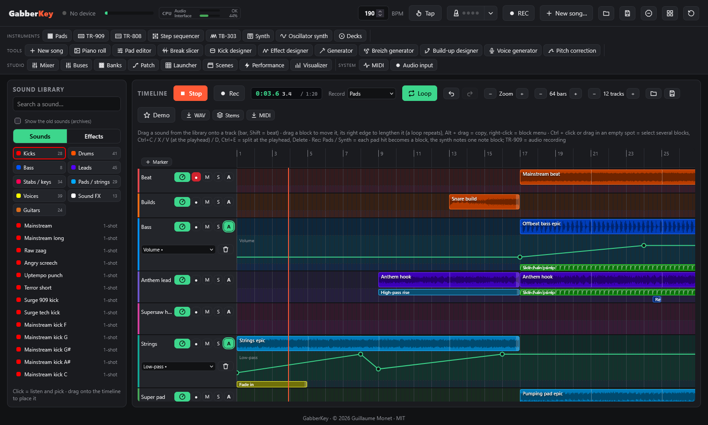
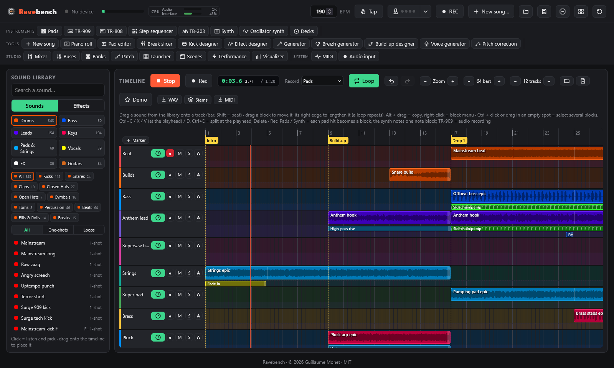
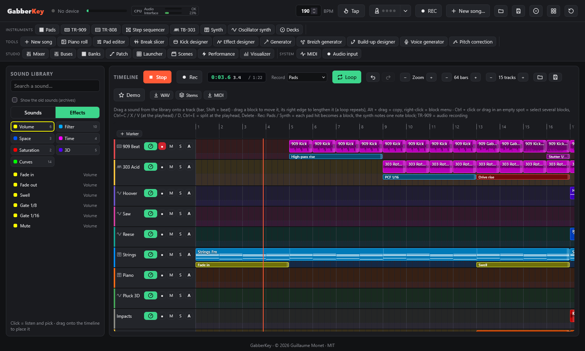
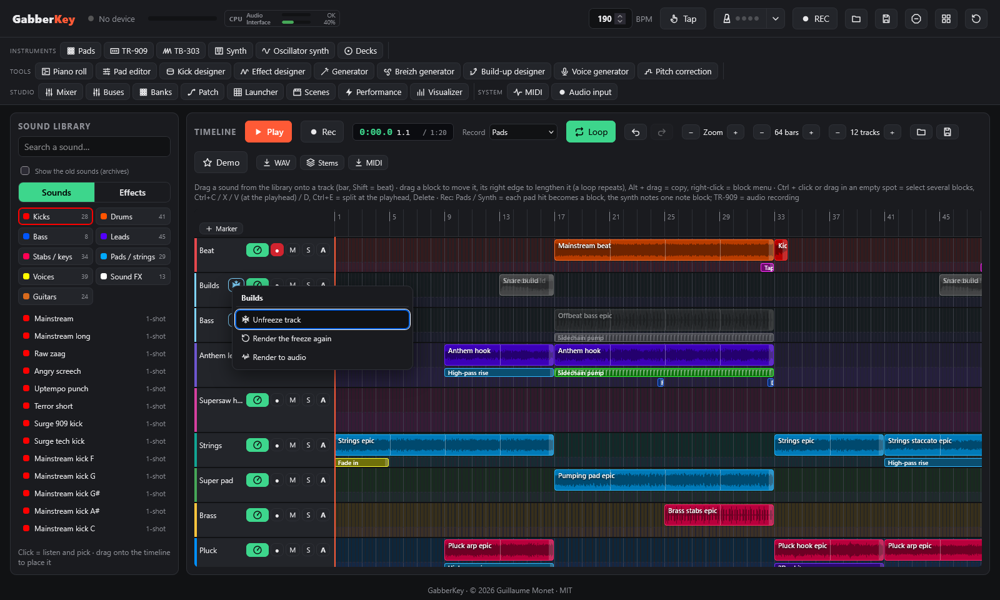
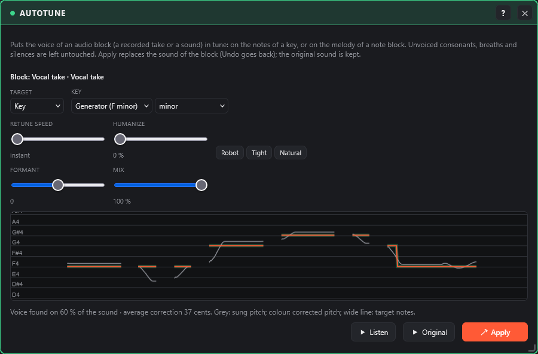
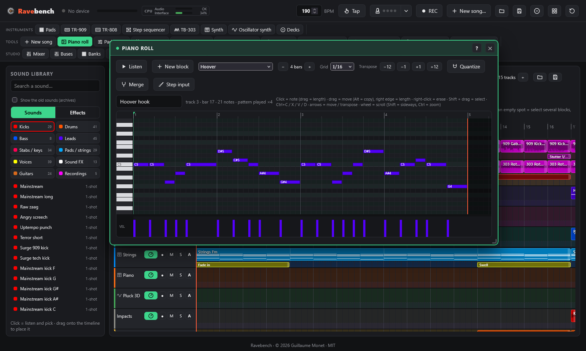
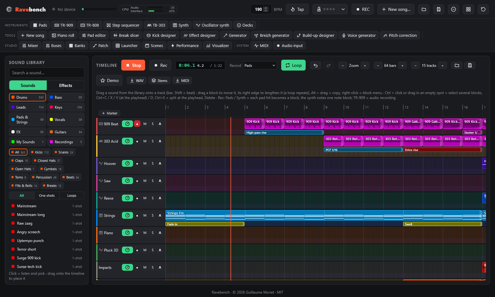

# Timeline, library and piano roll

← [Pads and banks](pads.md) · [Contents](README.md) · [Instruments](instruments.md) →

The main screen: tracks, blocks, sound library, track effects, piano roll and demos.

## Timeline and sound library

The main screen: the **sound library** on the left, the **timeline** on the right (16 tracks and 32 bars to start, − / + to change the length and the number of tracks, from 4 to 64, zoom, **Loop**).

- **Library**: two tabs. **Sounds**: pick a category (Kicks, Drums, Bass, Leads, Stabs / keys, Pads / strings, Voices, Sound FX, Guitars, My sounds, Recordings). **Effects**: the track effects, by family (Volume, Filter, Space, Time, Saturation, 3D, and your Curves from the effect designer). Or search by name. **Click** a sound to listen to it (and pick it); the badge shows its length in bars (loops) or "1-shot".
- **Place**: drag a sound onto a track. It snaps to the start of the bar (hold **Shift** to place it on a beat). Clicking an empty cell places the last sound picked.
- **Edit blocks**: drag a block to move it (to another bar or track), drag its **right edge** to lengthen or shorten it (a loop repeats to fill the block), **Alt + drag** copies it, **double-click** listens to it (a note block opens in the **piano roll**), **Delete** removes it, and a **right-click** opens its menu (see below).
- **Block menu** (right-click): **Listen**, **Gain** (−24 to +12 dB, double-click = 0 dB), **Fade in** and **Fade out** (from 1/4 beat to 16 beats, drawn in the block), **Reverse** (the sound played backwards), **Keep the pitch** (audio block: the sound follows the song tempo without changing key), **Transpose** (−12, −1, +1, +12 semitones: the notes of a note block, or the pitch of a sound without changing its speed), **Split here** (where you clicked, snapped to the beat; Shift = to 1/16) or **Split at the playhead**, **Duplicate after**, **Send to…** (an 8 × 5 grid like the APC: a chosen **pad** of a chosen **bank**, or a **launcher** slot; occupied cells show their sound, a replaced pad keeps its knobs; a note block or part of a sound is rendered to audio first for the pad; **Include the track effects**, unticked by default, puts the track effects in the pad sound: effect blocks, inserts, filters, drive, reverb and delay sends), **Open in the piano roll**, **Pitch correction…** (audio block: see [Pitch correction](#pitch-correction)), **Render to audio** (see [Freeze a track, render to audio](#freeze-a-track-render-to-audio)), **Delete**. On a selected block, the settings apply to **the whole selection**. Everything can be undone with Ctrl+Z and is heard in the WAV export. The gain of a note or pad block sets how hard its notes hit. **Keep the pitch**: a sound placed from the library has it by default; a 150 BPM loop played at 190 then stays in its key instead of going up 4 semitones. The sound is computed once (time-stretching), in the background, when you place the block or change the tempo; until then the block plays the old way. Blocks of songs saved before this option keep the old way until you turn it on.
- **Split a block**: a sound split in two sounds exactly the same (the second half carries on in the sound), a note block keeps its notes on each side; the fade in stays on the first half, the fade out on the second. **Ctrl+E** splits the selected blocks at the playhead (with no selection: those of the armed tracks).
- **Playback time** (next to Rec): the time elapsed since the start of the song, the bar.beat position, and the length of the song (up to the end of its last block); it follows the playhead, while playing or when you move it.
- **Listen to a block**: the **▶** button that appears on a block when the mouse is over it (or a double-click on a sound block) plays that block on its own, as it sounds in the song: at the tempo, for its whole length, with its track's knobs (but without its track effects); a bar runs along the block, and **■** stops it. It does not disturb the song if it is playing.
- **Name and colour**: double-click a track's name to rename it; its panel (dial button) also has the name and a background colour for the track.
- **Track knobs**: the dial button of each track opens its panel and knobs: **volume**, **pan**, **low-pass** and **high-pass** filters, **delay** and **reverb** sends, **drive** (the TR-909 "tube" saturation: transparent at 0, level compensated as it goes up). They act on everything the track plays, are saved with the song, undone with Ctrl+Z and included in the WAV export and the stems. The button lights up when a knob is no longer at its default value; **Reset** puts them all back.
- **Mute and solo**: **M** mutes the track, **S** solos it (only soloed tracks are heard; several tracks can be soloed). They act at once, even while playing, and the WAV export follows what you hear. A muted track does not trigger the sidechain.
- **Insert effects**: in a track's panel, **Add effect** puts up to 4 **always-on** effects on the whole track: 3-band EQ, compressor, distortion, filter, reverb. They come before the track's knobs; double-click a setting to reset it. **Effect blocks** (below) only act for their length.
- **Bus**: a track's panel can also send it to a **bus** (A to D), to process it with other tracks: see [Buses](mixing.md#buses).
- **Select several blocks**: **Ctrl + click** adds a block to the selection (or removes it), **drag in an empty spot** draws a selection box (Shift or Ctrl adds to the selection), **Ctrl+A** selects everything. Drag one of them to move the whole group (Alt = copy it). Track effect blocks are selected the same way.
- **Copy / paste**: **Ctrl+C** / **Ctrl+X**, then **Ctrl+V** pastes at the playhead, on the same tracks (the playhead moves to the end of what was pasted, so pressing again chains copies); **Ctrl+D** duplicates the selection right after itself; **Delete** removes it; **Esc** deselects.
- **Undo / redo**: **↶ / ↷** in the toolbar, or **Ctrl+Z** / **Ctrl+Shift+Z** (or **Ctrl+Y**). Every change to the timeline can be undone (placed, moved, lengthened, split or deleted blocks, gain and fades, generated chords, recordings, markers, demo loading…), and so can the **buses** (tracks sent, effects), the **pads** (sound placed, replaced or removed, bank cleared: imported sounds are kept until the next start so they can come back), the TR-909 and TB-303 **patterns** and the **scenes**, up to 100 steps. Turned knobs and faders are not part of it; one gesture on an insert effect slider counts as a single step.
- **Record by playing (live)**: arm one or **several tracks** (●), choose in each track's panel the **instrument it records** (Pads, Step sequencer, Synth, Oscillator synth, TR-909, TR-808, TB-303, Decks, or Auto = the **Record** menu of the toolbar; the track header shows its icon), set the playhead (click the ruler), then **● Rec** (or REC on the APC). Every armed track records its instrument at the same time, and the timeline plays (in a loop if Loop is on, unless an instrument is recorded as audio):
  - **Pads**: every pad hit becomes a block of that pad, where you hit it (snapped to the 16th note). The block replays the pad with its settings.
  - **Synth**: every note appears live and **grows while you hold the key**; when the recording stops, the notes of the take become **one note block** (from bar to bar), which replays with the synth that was played (current synth preset, or the oscillator synth) and opens in the piano roll.
  - Blocks appear live as you play, on the track that records the instrument. If it is taken at that moment, the block goes to the next free track (never to a track armed for another instrument). The notes go to the track of the synth the keyboard is playing. With Loop on, you can add hits on every pass.
  - **Step sequencer**: it starts with the recording; each of its hits becomes a block of the pad played, with its velocity.
  - **TR-909** / **TR-808** / **TB-303** / **Decks**: the instrument starts on the timeline's bars and is recorded as audio into a block (also listed in the library under Recordings).
  - **■ Stop rec** (or REC again) ends the recording.
- **Play**: ▶ (or PLAY on the APC) plays from the playhead, and the same button stops; the view follows the playhead. Loops recorded at another tempo follow the global tempo. The timeline has its own channel in the mixer.

### Automation

Make a track setting move along the song: a filter opening during the build-up, a bass fading in, a reverb growing over the break…

- The **A** button in a track header opens its **automation lane**, under its blocks. In the header, choose the setting: **volume**, **pan**, **low-pass**, **high-pass**, **delay** and **reverb** sends, **drive** (a dot • marks those with a curve).
- **Click** in the lane: a point (snapped to the quarter beat, Shift = free). **Drag** a point: move it. **Right-click**: delete it. The bin clears the whole curve of the setting.
- Between two points the setting follows a straight line; before the first and after the last it keeps their value. With no curve, the dotted line shows the knob value.
- **While playing**, the curve replaces the track knob; when stopped, the knob takes over again. A curve changed while playing is heard at once.
- The A button lights up when the track has curves. Automation can be undone with Ctrl+Z, is saved with the project and in song files, and is heard in the WAV export and the stems.

### Insert or delete bars

**Right-click a bar number** (the ruler at the top of the timeline): a menu to **insert** 1, 2, 4, 8 or 16 empty bars there, or **delete** as many from there. Handy to lengthen a break or add a build-up in the middle of a song already built.

- **Insert**: everything after moves right, on every track: blocks, effect blocks, automation, markers, playhead. A block across that point is cut in two; an effect block across it is lengthened; automation holds its value during the added bars.
- **Delete**: what those bars contain goes away (blocks across the edges are cut there), and everything after moves left.
- The song gets longer or shorter by as much. Ctrl+Z undoes it.

### Markers

Named landmarks (intro, build-up, drop, break…) under the bar numbers, with a dotted line across every track.

- **+ Marker** (corner of the ruler) adds one at the start of the playhead's bar; a **double-click in the ruler** adds one at that bar.
- **Click** a marker: the playhead goes there (playback restarts from there if it was running). **Drag**: move it, snapped to the bar (Shift = to the beat). **Double-click**: rename it. **Right-click**: delete it.
- **Alt+← / Alt+→**: previous / next marker (after a click in the timeline).
- Markers can be undone with Ctrl+Z and are saved with the project and in song files.

### Track effects

Each track has two parts: the **sounds** on top, and a thin **effects line** underneath. Drag an effect from the **Track FX** category of the library onto a track: it acts on **everything the track plays** (audio blocks, synth notes and chords, pad hits) **for the length of the block**, in time with the tempo. Effects add up: a fade in and a PCF at the same time both apply; overlapping effect blocks stack on several lines.

- **Edit** an effect block like a sound block: drag it (Alt = copy), drag its right edge to change its length, right-click or **Delete** to remove it, **double-click** to open its settings.
- **The effects bank** (30 effects, each with its own settings):

| Family | Effects |
|---|---|
| Volume | Fade in, Fade out, Swell, Gate 1/8 and 1/16, Mute |
| Filter | High-pass rise, Low-pass close, Wobble 1/4 and 1/8, **PCF** 1/8, 1/16, offbeat, gallop, 3-3-2, band-pass |
| Space | Reverb throw, Delay throw (the echoes keep going after the block), Auto-pan |
| Time | Stutter 1/8, 1/16, 1/32, Tape stop |
| Saturation | Drive rise, Bitcrush rise |
| 3D | 3D orbit, 3D fly-by, 3D zoom in / out, 3D spiral (binaural: best with headphones) |

- **PCF** is a rhythmic filter: low-pass (LP) or band-pass (BP), whose envelope restarts on each active step of a 16-step **pattern** (1/8, 1/16, 1/4, offbeat, gallop, 3-3-2, roll), with **Frequency**, **Q**, **Amount** and **Decay**.
- Everything is scheduled on the audio clock: effects stay in time, are undone with Ctrl+Z, and are included in the WAV export and the stems.

### Freeze a track, render to audio

The browser has little computing power: a heavy track (layered synth chords, track effects, inserts, drive) can make the sound choppy. **Freeze it**: it is rendered to audio once, offline (a few seconds), then that audio plays instead of its blocks.

- **Freeze**: right-click a track header › **Freeze track** (or the **Freeze track** button of its panel, dial button). A **snowflake** shows in the header (it blinks while rendering; meanwhile the track plays live), and its blocks are **greyed and locked**: they can no longer be moved or edited, and nothing can be placed or recorded on the track. Click the snowflake for the track menu.
- **What the frozen sound contains**: the track blocks, its track effects, its insert effects, its low-pass / high-pass filters and its drive (with their automation), then the mixer channel and the sidechain, as they are when you freeze. **What stays live**: **volume**, **pan**, the **delay** and **reverb** sends (and their automation), **mute / solo** and the **bus**. The mix stays adjustable; the knobs baked into the sound are greyed in the panel.
- The kicks of a frozen track still pump the sidechain of the other tracks.
- **Unfreeze**: track menu › **Unfreeze track**: the blocks play live again and can be edited. **Render the freeze again** redoes the sound after you change an instrument, the mixer or the sidechain (the frozen sound does not follow them). A tempo change redoes the sound by itself.
- **Saving**: only the "frozen" state is saved with the project, not the sound (it would be too heavy): it is rendered again in the background when the project opens. Freezing and unfreezing can be undone with Ctrl+Z.
- **Render to audio**: track menu › **Render to audio**: the track (blocks, effects, inserts, filters, drive) becomes **one audio block** on the first free track below (or a new track), which takes its volume, pan, sends, bus and their automation; the original track is **muted** (it stays there for later). From a block menu, **Render to audio** does the same with the selected blocks of that track, which are removed. The sound is rendered without the mixer (it will go through the Timeline channel), stored in the library (Recordings) and saved with the project. Everything can be undone with Ctrl+Z.
- The **WAV export** and the **stems** play the blocks of a frozen track again (offline rendering has no limit); the **launcher** plays its clips live.

### Pitch correction

Puts a recorded voice in tune: an **audio block** of the timeline (a take recorded with REC or from the audio input, an imported sound, a rendered voice). Right-click the block › **Pitch correction…** opens the window (Tools group); while it is open, it follows the selected audio block.

- **Target**: **Key** (each sung note goes to the nearest note of the scale: minor, major, harmonic minor, phrygian, minor pentatonic or chromatic; **Generator** takes the key of the Generator chords), or **Note block** (the voice follows the melody of a lead or chord block, by default the one under the take; each note is taken in the octave closest to the voice).
- **Retune speed**: 0 = instant, the robotic effect (the voice jumps from note to note in clean steps); from 50 to 400 ms the correction reaches the note gradually and the voice stays natural (slides and attacks kept). **Humanize** keeps the vibrato and the small inflections around the right note. The **Robot**, **Tight** and **Natural** buttons set both at once.
- **Formant**: smaller (+) or bigger (−) voice, in semitones, without changing the pitch. **Mix**: corrected voice / original voice (below 100 %, a doubling effect).
- The **curve** shows the sung pitch (grey), the corrected pitch (colour) and the target notes (wide line), with the share of the sound where a voice was found and the average correction in cents. **Listen** plays the corrected block alone, **Original** the block as it was.
- **Apply**: the block now plays the corrected voice (stored in the library, Recordings, and saved with the project). Ctrl+Z goes back. The original sound is kept with the block: opening the pitch correction again starts from it (with the applied settings), **Remove** puts it back.
- Only the clearly pitched parts are processed (pitch measured every 5 ms): unvoiced consonants (s, f, t…), breaths, noise and silences stay **exactly** as recorded, and octave errors of the measurement are fixed before the correction. The timbre is kept (the formants do not move, except with the Formant setting). Best results on a dry, solo voice: no reverb, no other instrument in the take.

## Piano roll

Edits the notes of a **note block** of the timeline (synth recordings, generated pads, chords, arpeggios, or a new block).

- **Open a block**: double-click a note block on the timeline (while the window is open, a click is enough), or **+ New block** (1 bar at the playhead, on the armed track). A **synth recording becomes a single note block**, ready to edit.
- **Draw**: click an empty spot to add a note (drag to set its length), drag a note to move it (**Alt** = copy), drag its right edge for its length, **right-click** to erase. **Shift + drag** selects a group.
- **Transpose** (−12, −1, +1, +12): moves the selected notes, or all the notes of the block if none is selected, by a semitone or an octave.
- **Keys**: Delete, Ctrl+A / C / X / V (paste at the green cursor, set by clicking the ruler), **Ctrl+D** duplicates after itself, ↑ / ↓ transpose (Shift = octave), ← / → move by one grid step (Shift = one bar), **Q** quantizes, **Space** listens, Ctrl+Z undoes.
- **Velocity**: drag in the bottom lane.
- **Grid** from 1/4 to 1/32, with triplets; **Quantize** snaps the start and end of the notes. The rows of the F minor scale (the key of the banks) are tinted.
- **Length** −/+ sets the length of the **pattern**: on the timeline the block repeats it over its whole length (drag its right edge), like a loop. Notes drawn after the end lengthen the pattern.
- **Sound**: each block can have its own synth preset, or play the sound currently on the keyboard. A block with its own preset keeps that preset's drive and chorus; those of the keyboard synth only apply to the blocks that play the current sound. **Merge** gathers the neighbouring note blocks of the track (same sound) into one.
- **Step input**: the notes played on the APC keyboard (or the computer keyboard) go in at the cursor, chords included, and the cursor moves on by one grid step.
- **▶ Listen** loops the pattern alone; while the timeline plays, the playhead is shown in the piano roll too.

## Demo

Click **Demo** in the timeline toolbar and choose a song. Press ▶ to listen, then change it as you like.

- **Demo 1: library loops**: about one minute at 190 BPM in F minor, built from the Gabber, Hardcore and Oldschool banks (intro with strings, gabber build-up with hoovers, first drop, oldschool break with Amen break, piano and choir, hardcore second drop with screech and strings, final kick build-up). Listen: [`demo/gabberkey-demo.ogg`](../../demo/gabberkey-demo.ogg) (rendered by `tools/render_demo.py` from `demo/demo.json`).
- **Demo 2: every tool**: 64 bars of hardcore at 190 BPM in F minor (Fm, Db, Eb, C), made in the app with as many tools as possible, on 15 named and coloured tracks:
  - **TR-909** (Rotterdam kit) and **TB-303** (Rotterdam sound) recorded live: gabber beat, kick roll, kick alone, acid line and squelch line;
  - **oscillator synth**: hoover hook, reese bass on the offbeats, supersaw an octave up, pluck (every melody is a note block you can open in the **piano roll**);
  - **layered synth**: epic strings and rave piano stabs;
  - a kick from the **kick designer** (Terror) on each drop;
  - library sounds: hats, snare builds, risers, crashes, impacts, shouts, screech, siren, choir;
  - **track effects**: filter rise and close, pumping filter, drive rise, wobble, stutter, tape stop, gate, reverb and delay throws, autopan, and the **3D** orbit, spiral, fly-by and zoom;
  - **track knobs**: volume, pan, filters, delay and reverb sends.

  Intro with strings and air-raid siren, build-up (acid line, snare build, "hey!"), first drop, break with piano and a pluck turning around you in 3D, second drop with supersaw, outro. Listen: [`demo/gabberkey-demo-2.ogg`](../../demo/gabberkey-demo-2.ogg). It is a song file ([`demo/gabberkey-demo-2.gabber`](../../demo/gabberkey-demo-2.gabber)): the 909 / 303 takes and the designer kick travel inside it.
- **Demos 3, 4 and 5**, made only with the new **Anthem** library (64 bars at 190 BPM in F minor, about 1:20 each), with track effects, curves from the effect designer and 3D:
  - **Anthem** (epic progression Fm–Db–Eb–Cm): strings intro, pluck build-up rising through a high-pass filter, a first drop with the supersaw anthem lead, bass and pad pumped by sidechain-pump curves, a break with the pluck orbiting in 3D, a kick-roll build-up, and a second drop with the angry beat, supersaw hook, brass and a 3-3-2 gated screech. Listen: [`demo/gabberkey-demo-3.ogg`](../../demo/gabberkey-demo-3.ogg).
  - **Raw** (dark progression Fm–Bbm–Db–C): dark strings intro, a raw beat opening through a high-pass filter, a first drop with the dark lead, rolling bass and pumping pad, a break opened by a long zaag kick with the strings spiralling in 3D, a kick-roll build-up, and a second drop with the angry beat where the screech (filter-wobble curve, 3D fly-by) and ping-pong stabs come in. Listen: [`demo/gabberkey-demo-4.ogg`](../../demo/gabberkey-demo-4.ogg).
  - **Euphoric** (euphoric progression Fm–Db–Ab–Eb): uptempo beat, euphoric lead, trance hooks with an offbeat-echo curve, a swelling and breathing pad, a pluck zooming in 3D, and a melody played with the tuned kicks before the last drop. Listen: [`demo/gabberkey-demo-5.ogg`](../../demo/gabberkey-demo-5.ogg).

---

← [Pads and banks](pads.md) · [Contents](README.md) · [Instruments](instruments.md) →
