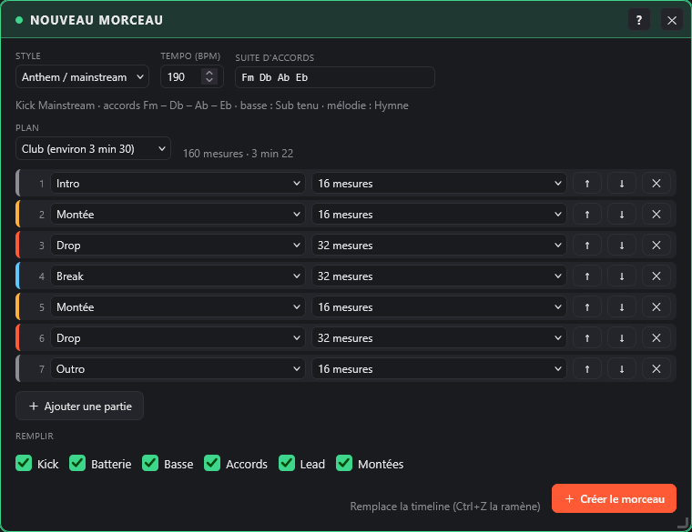
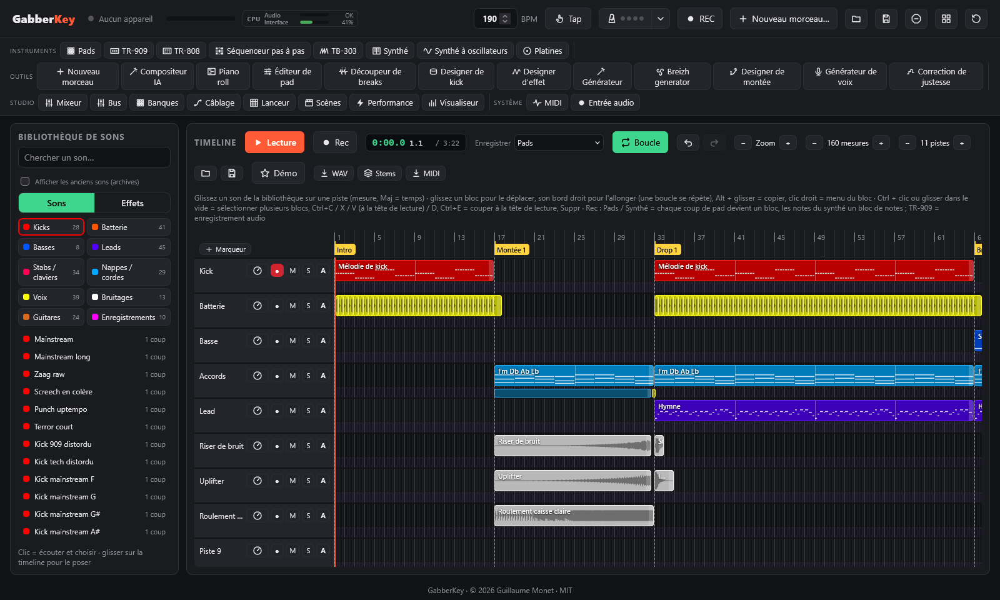
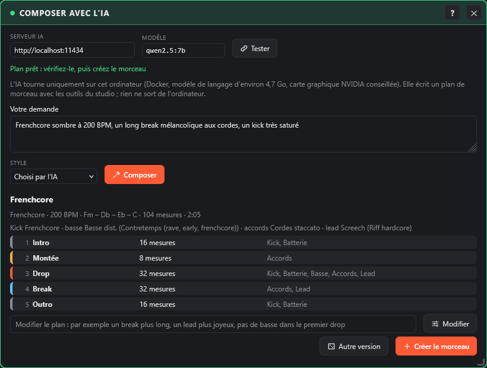

# Premiers pas

[Sommaire](README.md) · [Le contrôleur APC Key 25](apc.md) →

Ce qu'il faut, l'installation, le lancement, un premier morceau en quelques secondes, le compositeur IA et la langue de l'interface.

## Prérequis

- Un **Akai APC Key 25**, mk1 ou mk2. Il est facultatif : tout marche aussi à la souris et au clavier de l'ordinateur.
- **Google Chrome**, **Microsoft Edge** ou **Firefox** (version 108 ou plus). Safari ne gère pas le Web MIDI.
- **Python 3**, uniquement pour servir la page en local (le Web MIDI exige `localhost` ou HTTPS).
- Le **WebGL** (présent dans tous les navigateurs récents) pour les modes 3D et les filtres du visualiseur ; sans lui, les modes 2D marchent quand même.

## Installation

```bash
git clone https://github.com/guillaumemonet/gabber-apckey25.git
cd gabber-apckey25
```

Ou téléchargez le ZIP depuis GitHub et décompressez-le.

## Lancement

1. Branchez l'APC Key 25.
2. Lancez le serveur local :
   - **Windows** : double-clic sur `start.bat`.
   - **macOS / Linux** : `./start.sh`.
   - **Partout** : `python tools/serve.py`, puis ouvrez http://localhost:8025.
3. Dans le navigateur, cliquez sur **Démarrer**, puis **autorisez les appareils MIDI** quand le navigateur le demande.

L'en-tête affiche **1 appareil branché** avec un point vert quand le contrôleur est détecté ; un clic dessus montre la liste des appareils (APC Key 25 mk1 ou mk2, autres appareils MIDI).

## Nouveau morceau : démarrer par un style

**Nouveau morceau…** (en-tête, ou barre des plugins, groupe Outils) lance un morceau en quelques secondes.

[](../screenshots/start-fr.png)

1. **Style** : il règle le tempo, la suite d'accords, le kick (preset du designer de kick), le rythme de la batterie, la ligne de basse, les sons des accords et du lead. Le **tempo** et la **suite d'accords** se changent avant de créer.

   | Style | Tempo | Kick | Basse | Mélodie |
   |---|---|---|---|---|
   | Early hardcore | 175 | Early | le kick | riff, early hoover |
   | Gabber (Rotterdam) | 185 | Rotterdam | le kick | riff, hoover |
   | Anthem / mainstream | 190 | Mainstream | sub tenu dans les breaks | hymne, lead hardstyle |
   | Frenchcore | 200 | Frenchcore | contretemps | riff, screech |
   | Uptempo | 210 | Uptempo | le kick | riff dense, screech |
   | Industrial | 160 | Industrial | le kick | riff aéré, alarme |
   | Terror | 240 | Terror | le kick | riff dense, screech |
   | Happy hardcore | 175 (tonalité majeure) | 909 | octaves | hymne dense, supersaw |
   | Rave | 145 | 909 | marche (reese) | riff, mentasm |
   | Hardstyle | 150 | Raw | reverse bass | hymne, lead hardstyle |
   | Breizhcore | 190 | Mainstream | contretemps | l'air du Breizh generator |

2. **Plan** : **Club** (intro 16, montée 16, drop 32, break 32, montée 16, drop 32, outro 16 : environ 3 min 30 à 190 BPM), **Court** (une maquette d'environ 1 min 20) ou **DJ** (intro et outro de 32 mesures, kick et batterie seuls, pour mixer). Chaque partie (Intro, Montée, Drop, Break, Outro) a sa longueur (4 à 32 mesures) ; ↑ / ↓ la déplacent, ✕ la supprime, **Ajouter une partie** en ajoute une. La longueur totale est affichée.
3. **Remplir** (tout coché par défaut) :
   - **Kick** : une mélodie de kick (un kick par temps, sur les fondamentales des accords) dans l'intro, les drops et l'outro ;
   - **Batterie** : charleston et clap des banques « Anthem drums » ou « Early hardcore », crash au début de chaque drop ;
   - **Basse** : la ligne du générateur de basse dans les drops (le sub de l'anthem dans les breaks) ; pour les styles où la queue du kick fait la basse, la case est décochée : cochez-la pour ajouter quand même une basse en contretemps dans les drops ;
   - **Accords** : montées, drops et breaks ;
   - **Lead** : drops, et une version plus aérée dans les breaks ;
   - **Montées** : le **designer de montée** juste avant chaque drop (bruit et note qui montent, roulement de caisse claire et de kick, sub drop, impact, filtre qui monte sur les autres pistes, silence avant le drop).
4. **Créer le morceau** remplace la timeline (après confirmation ; **Ctrl+Z** la ramène en une fois) : une piste nommée par élément, un bloc par partie, un **repère** au début de chaque partie. Le **Générateur**, le **designer de kick** et le **synthé du clavier** prennent les réglages du style : régénérez une mélodie ou une ligne de basse, changez de kick, tout se retouche ensuite comme d'habitude.

[](../screenshots/start-song-fr.png)

## Compositeur IA (optionnel)

**Compositeur IA** (barre des plugins, groupe Outils) compose un morceau à partir d'une demande en quelques mots, par exemple « frenchcore sombre à 200 BPM, un long break mélancolique aux cordes, un kick très saturé ». Un modèle de langage qui tourne **sur votre ordinateur** écrit un **plan de morceau** avec les outils du studio : style, tempo, suite d'accords, réglages du kick, batterie, basse, sons, parties et ce qui joue dans chacune. Rien n'est envoyé sur Internet.

[](../screenshots/ai-fr.png)

### Installer le serveur IA

Le serveur IA est un conteneur Docker, à installer une seule fois. GabberKey fonctionne sans lui : seule cette fenêtre en a besoin.

1. Installez [Docker Desktop](https://www.docker.com/products/docker-desktop/). Avec une carte graphique NVIDIA, installez aussi son pilote à jour : Docker l'utilise directement.
2. Dans le dossier de GabberKey, lancez :

   ```
   docker compose -f ai/docker-compose.yml up -d
   ```

   Le premier lancement télécharge le serveur (environ 2 Go) et le modèle (`qwen2.5:7b`, environ 4,7 Go, licence Apache 2.0). Le serveur redémarre ensuite tout seul avec Docker.
3. Sans carte graphique NVIDIA, le modèle tourne sur le processeur, plus lentement (une à deux minutes par plan) :

   ```
   docker compose -f ai/docker-compose.yml -f ai/docker-compose.cpu.yml up -d
   ```

Avec une carte graphique de 8 Go, un plan arrive en 3 à 10 secondes (la toute première demande charge le modèle et prend plus de temps). Pour arrêter le serveur : `docker compose -f ai/docker-compose.yml down` ; pour supprimer aussi le modèle téléchargé : ajoutez `-v`.

### Composer

1. **Serveur IA** et **Modèle** : `http://localhost:11434` et `qwen2.5:7b` par défaut. **Tester** vérifie que le serveur répond et que le modèle est là. Un autre modèle de la bibliothèque Ollama peut être utilisé : téléchargez-le avec `docker exec gabberkey-ai-ollama-1 ollama pull <modèle>`, puis tapez son nom.
2. **Votre demande**, un **Style** si vous voulez l'imposer, puis **Composer**. L'avancement s'affiche ; **Arrêter** abandonne la demande.
3. Le plan est **vérifié** avant d'être montré : une valeur que le studio ne connaît pas est remplacée par celle du style (le nombre est indiqué, le détail au survol), un morceau sans drop en reçoit un, et la basse ne joue pas dans les styles où la queue du kick la fait, sauf si la demande en veut une. Le résumé donne le style, le tempo, les accords, la durée, les sons et chaque partie avec ce qui y joue.
4. **Modifier** : décrivez le changement avec vos mots (« un break plus long », « pas de basse dans le premier drop », « plus rapide ») ; l'IA renvoie le plan modifié. **Autre version** redemande le même morceau.
5. **Créer le morceau** le construit comme [Nouveau morceau](#nouveau-morceau--démarrer-par-un-style) : la timeline est remplacée (**Ctrl+Z** la ramène), le générateur, le designer de kick et le synthé du clavier prennent les réglages du plan.

La mélodie et la ligne de basse sont écrites par les générateurs du studio, dans le style et la densité choisis par l'IA, et changent à chaque version. Le modèle est petit : il lui arrive d'oublier une montée ou de mal comprendre une demande. Le plan reste un point de départ, à retoucher comme n'importe quel morceau.

## Langue

L'interface suit la langue du navigateur : français si le navigateur est en français, anglais sinon. Pour forcer une langue, ajoutez `?lang=fr` ou `?lang=en` à l'adresse.

## Compatibilité matérielle

GabberKey est développé et testé avec un **Akai APC Key 25 mk1**. Le **mk2** est pris en charge d'après la documentation MIDI d'Akai Professional, mais n'a pas encore été essayé sur un vrai appareil. Tout fonctionne aussi à la souris et au clavier de l'ordinateur.

---

[Sommaire](README.md) · [Le contrôleur APC Key 25](apc.md) →
