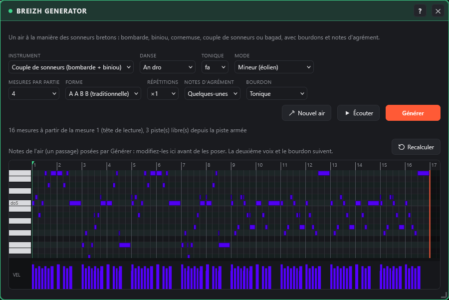
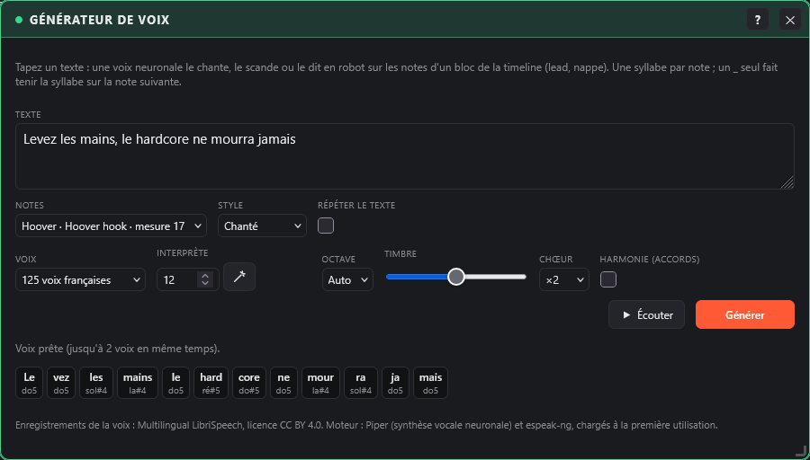
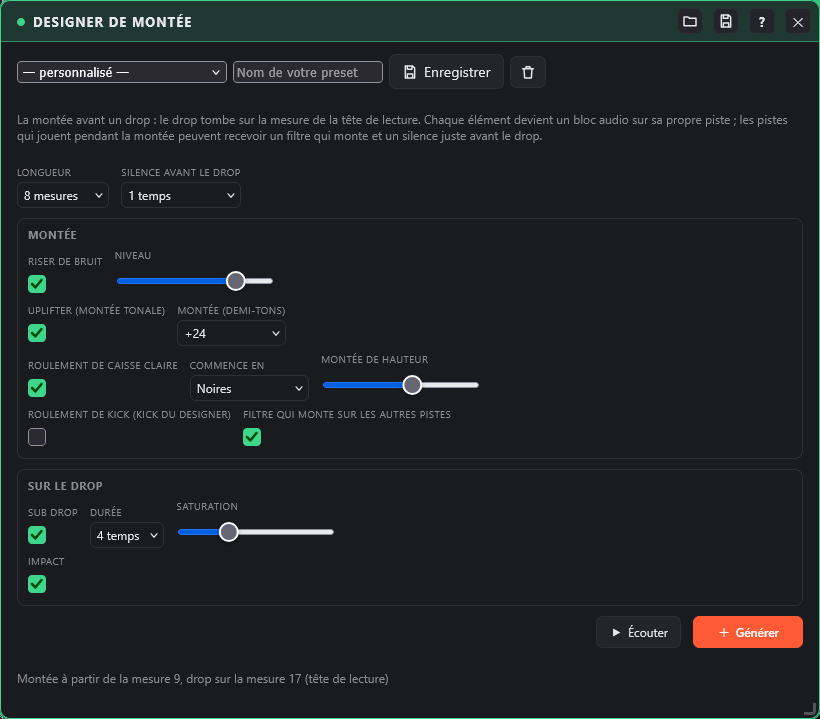

# Générateur : accords, mélodie et basse

← [Instruments](instruments.md) · [Sommaire](README.md) · [Mixage et effets](mixage.md) →

La fenêtre **Générateur** (barre des plugins, groupe Outils) part d'une suite d'accords et pose sur la timeline, au choix (trois onglets), des **blocs d'accords** (cordes, nappes, chœurs…), une **mélodie (lead)** ou une **ligne de basse** qui suivent ces accords.

**Accords**

- **Suite d'accords** : tapez les accords séparés par des espaces ou des tirets (`Fm Db Eb Cm`, `Fm-Bbm-Db-C`…), ou cliquez sur une suite toute prête. Reconnus : majeur (`Db`), mineur (`Fm`), `7`, `m7`, `maj7`, `sus2`, `sus4`, `dim`, `aug`, `5`, `add9`, avec `#` / `b`.
- **Son** : le preset du synthé en cours, ou un preset parmi les familles cordes, nappes, chœurs, supersaw, stabs ou claviers. Chaque bloc garde **son propre preset** : vous pouvez jouer autre chose au clavier, ou changer de preset, sans changer les nappes.
- **Registre** (grave, médium, aigu), **mesures par accord** (1, 2 ou 4), **répétitions** (×1, ×2, ×4), **rythme** (tenu, chaque temps, contretemps, croches).
- **Basse** : aucune, sub (tenue), hardcore en contretemps ou reese (tenue), sur la fondamentale de chaque accord, sur une deuxième piste. Pour une vraie ligne de basse, utilisez l'onglet **Basse**.
- Les accords s'enchaînent en douceur : les notes communes sont gardées et les autres bougent le moins possible.
- **▶ Écouter** joue le premier accord ; **Générer** pose les blocs à partir de la mesure de la tête de lecture, sur la première piste libre sur toute la durée, en partant de la piste armée. La timeline s'allonge si besoin.

Un bloc d'accord se manipule comme les autres : le déplacer, l'allonger, le copier (Alt), l'ouvrir dans le piano roll (double-clic) ou le supprimer.

**Mélodie (lead)**

- Même **suite d'accords**, mêmes **mesures par accord** et **répétitions** que l'onglet Accords : la mélodie suit l'harmonie.
- **Style** : **Hymne** (un motif repris sur chaque accord, comme un hook d'hymne hardcore), **Arpège**, **Riff hardcore** (notes courtes, octaves et quintes), **Question / réponse** (une phrase qui monte, une réponse qui descend). Les temps forts tombent sur les notes de l'accord ; entre eux, la mélodie passe par la gamme (sur un accord majeur en fa mineur, comme do, elle prend le mi bécarre).
- **Son** (supersaw, leads, hoovers, stabs ou le preset du synthé en cours), **densité** (aérée, moyenne, dense), **registre** (médium, aigu), **doublée à l'octave**.
- **Nouvelle idée** tire une autre mélodie et la fait écouter ; **Écouter** joue exactement ce que **Générer** posera (un deuxième clic arrête).
- La mélodie est posée en **un seul bloc de notes**, répété sur toute la durée : double-cliquez dessus pour la retoucher note par note dans le piano roll.

**Basse**

- Même **suite d'accords**, mêmes **mesures par accord** et **répétitions** : la ligne suit l'harmonie, la fondamentale de chaque accord sur ses temps forts.
- **Style**, dans les rythmes des styles hardcore :
  - **Sub tenu** : la fondamentale tenue sur tout l'accord (breaks d'hymne, nappes de basse) ;
  - **Contretemps** : une croche entre les temps, quand le kick ne joue pas (rave, early hardcore, frenchcore) ;
  - **Roulante** : trois doubles croches entre les temps (rave, hard trance) ;
  - **Reverse bass** : les deux doubles croches après le contretemps, la basse « ta-ka » de la hardstyle ;
  - **Octaves** : croches fondamentale / octave (happy hardcore) ;
  - **Marche** : fondamentale, quinte et octave en croches, parfois la tierce (rave) ;
  - **Acid** : doubles croches façon TB-303, avec silences, sauts d'octave, accents et glissés (avec le preset Acid bass du synthé à oscillateurs, les notes qui se chevauchent glissent).
- **Son** : les basses du synthé (Bass, Reese, Sub) ou celles du **synthé à oscillateurs** (Reese, Acid bass, Sub, Wobble), ou le preset en cours. **Octave** : grave (fondamentale entre fa1 et mi2) ou médium (une octave plus haut).
- **Note de passage** : sur le dernier contretemps de chaque accord, une note qui mène à l'accord suivant (un demi-ton ou un ton sous ou sur sa fondamentale, dans la tonalité).
- **Idée** tire une autre variante des styles Marche et Acid et la fait écouter. Comme la mélodie, la basse est posée en **un seul bloc de notes** répété, à retoucher dans le piano roll.

**Modifier les notes avant de les poser**

- Sous les réglages, un **piano roll** montre le **brouillon** de l'onglet affiché : les notes d'un passage de la suite d'accords (les accords dans l'onglet Accords, la mélodie dans l'onglet Mélodie). Il s'édite comme le [piano roll](timeline.md) : clic = poser une note, glisser = déplacer, bord droit = durée, clic droit = effacer, Maj + glisser = sélection ; touches Ctrl+C / Ctrl+V / Suppr / flèches quand il a le focus.
- Tant que le brouillon n'a pas été retouché, chaque réglage le recalcule. Une fois **retouché à la main**, les réglages ne le changent plus : **Recalculer** repart des réglages (Nouvelle idée aussi, pour la mélodie).
- **Écouter** et **Générer** utilisent le brouillon tel qu'il est affiché. Les accords sont posés en un bloc de notes par accord (chacun garde son nom), la mélodie en un seul bloc. Le brouillon est enregistré avec le projet.

**Suggestions (sans réseau de neurones)**

- **Suggestions** (onglet Mélodie) : le Générateur essaie une centaine de mélodies sur votre suite et vous propose les **trois meilleures**, différentes entre elles. La note vient de règles de hook d'hymne : temps forts sur les notes de l'accord, mouvements surtout conjoints, peu de grands sauts, ambitus d'environ une octave, motif repris d'un accord à l'autre, sommet vers la fin de la phrase, fin sur la fondamentale.
- **Écouter** une idée, puis **Choisir** : elle devient le brouillon de la mélodie. Chaque choix **apprend votre goût** (la moyenne des traits des idées choisies) : les suggestions suivantes s'en rapprochent de plus en plus. Le goût est enregistré avec le projet.
- **Suggérer des suites** (onglet Accords) : des suites d'accords d'hymne dans la tonalité de votre suite, construites à partir des enchaînements les plus courants du hardcore et du hardstyle en mineur (i, VI, VII, III, iv, v, V) ; un clic en utilise une.

Le **Générateur**, le **Breizh generator**, le **Designer de montée**, le **Générateur de voix** et la **Correction de justesse** ont une barre de presets comme les instruments : réglez, tapez un nom, **Enregistrer** ; vos réglages (★) se rappellent depuis le menu, la corbeille les supprime. Ils sont enregistrés avec le projet.

## Breizh generator

La fenêtre **Breizh generator** (groupe Outils) pose un air à la manière des sonneurs bretons, joué par des instruments bretons, avec son bourdon. Elle marche comme l'onglet Mélodie : un brouillon dans le piano roll, **Écouter**, **Nouvel air**, **Générer**.

- **Instrument** : bombarde (anche double, son puissant et nasillard), biniou kozh (petite cornemuse bretonne, très aiguë), cornemuse, **couple de sonneurs** ou **bagad**.
  - Couple : la bombarde et le biniou jouent ensemble, le biniou à l'octave au-dessus ; la bombarde respire à la fin de chaque phrase de deux mesures pendant que le biniou continue.
  - Bagad : un pupitre de cornemuses (neuf sonneurs, chacun un peu désaccordé), le pupitre de bombardes à l'octave au-dessous.
  - La cornemuse et le bagad jouent dans la gamme propre du chalumeau, accordée sur les bourdons, mesurée sur des enregistrements de sonneurs : seconde, tierce, quarte, quinte et sixte presque pures, le sol sous la tonique très bas (la septième « bémol » de la cornemuse), le sol aigu un peu haut. Les bombardes du bagad restent dans la gamme tempérée.
- **Danse** : le rythme de l'air.
  - **An dro** : croches régulières.
  - **Gavotte** : syncopée.
  - **Marche** : rythme pointé.
  - **Gwerz** : air lent, notes longues.
- **Tonique** et **mode** : mineur (éolien), dorien, mixolydien (le mode de la cornemuse) ou majeur. Pour un hymne en fa mineur, prenez fa et mineur (ou dorien).
- **Forme** : **A A B B** comme un air traditionnel (chaque partie jouée deux fois, la partie B plus haute) ou une seule partie **A**. Chaque partie est une question qui s'arrête sur la quinte, puis une réponse qui revient à la tonique ; la troisième mesure reprend le motif de la première pour que l'air se retienne.
- **Mesures par partie** (2 ou 4) et **répétitions**.
- **Notes d'agrément** : des notes très courtes juste avant les notes posées sur le temps, la signature des sonneurs. Pour la cornemuse et le bagad, le sol aigu du chalumeau (le la aigu sur le sol aigu), l'agrément le plus courant des sonneurs de cornemuse ; pour la bombarde et le biniou, la note au-dessus. **Beaucoup** en met plus souvent, parfois deux de suite.
- **Bourdon** : la tonique tenue sur toute la durée (et la quinte avec **Tonique + quinte**), sur sa propre piste. Chaque note du bourdon est un jeu complet : deux bourdons ténors presque à l'unisson, qui battent lentement, et un bourdon basse à l'octave au-dessous.

**Générer** pose un bloc par voix (mélodie, deuxième voix, bourdon) à partir de la mesure de la tête de lecture, sur des pistes libres depuis la piste armée. Le brouillon affiché est l'air de la mélodie : retouchez-le, la deuxième voix et le bourdon suivent.

Les sons existent aussi dans le synthé, famille **Breizh** : bombarde, pupitre de bombardes, biniou kozh, cornemuse, bagad (pupitre de cornemuses) et bourdon. Ils sont synthétisés, sans échantillon : formes d'onde d'anche, résonances du pavillon, souffle, et une hauteur qui bouge un peu comme celle d'un vrai sonneur. Leur timbre (onde et résonances) a été ajusté sur des enregistrements libres de droits de bombardes, de biniou, de chalumeau et de bourdons de cornemuse. Le niveau et le timbre bougent un peu, comme la pression d'un sac ou d'un souffle ; les cornemuses lient leurs notes sans interruption, la bombarde les détache d'un coup de langue. Dans les pupitres (bagad, bombardes), chaque sonneur est un peu désaccordé et attaque un peu à part des autres.

## Générateur de voix

La fenêtre **Générateur de voix** (groupe Outils) fait chanter un texte par une voix neuronale, sur les notes d'un bloc de la timeline : le lead, la nappe, une mélodie du Générateur.

1. Tapez le **texte**.
2. Choisissez le bloc de **notes** qui donne la mélodie et le rythme. Par défaut, c'est le bloc sélectionné, sinon le premier lead. **Aucun** (ou une timeline sans bloc de notes) : la voix est dite en rythme à partir de la mesure de la tête de lecture, une syllabe par croche ou par double croche (**Débit**), chaque temps plus appuyé.
3. Choisissez la **voix** et le **style**.
4. **Écouter**, puis **Générer** : la voix devient un bloc audio sur une piste libre, calé sur le bloc de notes. Les consonnes du début tombent juste avant la note, comme chez un vrai chanteur.

Le texte est découpé en syllabes, **une syllabe par note**. S'il y a plus de syllabes que de notes, le motif de notes recommence ; **Répéter le texte** reprend le texte jusqu'à la dernière note du bloc. Un **_** seul entre deux mots fait tenir la syllabe d'avant sur la note suivante (elle glisse d'une note à l'autre). Après un rendu, chaque syllabe s'affiche sous les boutons avec sa note : vérifiez le placement, et changez les notes dans le piano roll si besoin.

- **Style** :
  - **Chanté** : chaque syllabe prend la hauteur de sa note, la voyelle tient la note, avec un léger vibrato sur les notes longues et un peu de l'intonation naturelle de la voix.
  - **Scandé (MC)** : la voix garde son intonation parlée, seuls le rythme et le placement suivent les notes ; pour les annonces et les cris de MC. Elle passe dans une **chaîne de voix d'MC**, réglée d'après des voix d'MC hardcore : voix criée (elle monte vers 230 Hz), présence et brillance, attaques plus nettes, saturation, compression, puis un **écho** calé sur le tempo (croche, croche pointée ou noire, gauche / droite) qui s'efface sous la voix et remplit les silences. **Punch** règle la quantité de cri, de saturation et de compression (double-clic : valeur par défaut).
  - **Robot** : la note exacte, sans vibrato ni intonation.
  - **Vocodeur** : la voix, dite au rythme des notes, module un synthé (dents de scie) qui joue les notes ; avec **Harmonie**, tout l'accord. Le son vocodeur classique du hardcore ; les consonnes sifflantes restent audibles.
- **Voix** :
  - français : Siwis (femme), Gilles (homme), Jessica et Pierre, et un modèle de **125 voix françaises** ;
  - anglais : LJ (femme), **904 voix anglaises** et **109 voix britanniques**.
  - Dans les modèles à plusieurs voix, l'**interprète** se choisit par son numéro (ou au hasard avec la baguette).
- **Octave** : **Auto** chante au plus près de la hauteur naturelle de la voix (une voix d'homme ne chante pas un lead à l'octave d'origine) ; −2 à +2 décale par rapport aux notes écrites.
- **Timbre** : à droite, une voix plus petite et plus claire ; à gauche, plus grande et plus sombre. Double-clic : neutre.
- **Chœur** (×2, ×4, ×8) : la même ligne par plusieurs interprètes, un peu décalés en temps et en justesse, répartis en stéréo.
- **Harmonie (accords)** : sur un bloc d'accords (une nappe), une voix par note de l'accord, de la plus aiguë à la plus grave (jusqu'à 4), multipliée par le chœur (8 voix au plus).

Comment ça marche : le texte est converti en phonèmes (espeak-ng) et découpé en syllabes. Chaque phrase (jusqu'à un silence entre deux notes) est dite d'un seul tenant par la voix neuronale (Piper), avec une durée imposée à chaque phonème : la voyelle de chaque syllabe commence sur sa note, les consonnes d'attaque juste avant (comme un chanteur), la voyelle tient la note. Les liaisons entre les sons restent donc naturelles. Puis la hauteur est recalée note par note sur la phrase entière (la même correction que la fenêtre Correction de justesse : timbre conservé, consonnes sourdes intactes). La voix reste une voix parlée qui chante : un rendu de voix corrigée, plus proche d'un MC que d'une chanteuse de studio ; les voyelles très longues (plus d'une seconde) prennent un timbre plus figé.

**Téléchargement** : rien n'est chargé tant que le générateur ne sert pas. Au premier rendu, le navigateur télécharge le moteur (quelques Mo), le convertisseur de phonèmes (18 Mo) et la voix choisie (63 à 78 Mo), puis les garde : les fois suivantes, la voix est prête en quelques secondes. Il faut une connexion Internet la première fois.

**Licences** : seules des voix dont la licence permet tout usage, y compris commercial, sont proposées (CC0, CC BY, CC BY-SA, domaine public). La licence et la source de la voix choisie sont rappelées en bas de la fenêtre ; pour CC BY et CC BY-SA, citez-les dans les crédits de votre morceau. Le moteur Piper et espeak-ng (licence GPL) ne font pas partie de Ravebench : ils sont téléchargés depuis leurs dépôts publics.

Le bloc posé est un enregistrement comme une prise audio : enregistré avec le projet, avec le nom « Voix · » et le début du texte, et rangé dans la catégorie Voix de la bibliothèque.

## Designer de montée

La fenêtre **Designer de montée** (groupe Outils) fabrique la montée avant un drop. Placez la **tête de lecture sur la mesure du drop**, choisissez les éléments, **Écouter**, puis **Générer**.

- **Longueur** : 2, 4, 8 ou 16 mesures avant le drop.
- **Silence avant le drop** : aucun, un demi-temps, un temps ou deux temps. Les pistes qui jouent pendant la montée sont coupées juste avant le drop (un bloc d'effet « Muet » sur chacune) : le drop frappe plus fort.
- **Montée** :
  - **Riser de bruit** : un bruit filtré qui monte, son **niveau** réglable ;
  - **Uplifter** : trois scies désaccordées qui montent de 12, 24 ou 36 demi-tons, le filtre qui s'ouvre ;
  - **Roulement de caisse claire** : il commence en noires, croches ou doubles croches et se resserre à chaque quart de la montée jusqu'aux triples croches, avec un crescendo et une **montée de hauteur** (0 à 12 demi-tons) ;
  - **Roulement de kick** : le même roulement avec le kick du designer de kick ;
  - **Filtre qui monte sur les autres pistes** : un bloc d'effet « Passe-haut qui monte » sur chaque piste qui joue pendant la montée.
- **Sur le drop** : **Sub drop** (un sinus qui tombe de 90 à 30 Hz sur 2, 4 ou 8 temps, avec sa **saturation**) et **Impact** (coup sourd et souffle qui retombe).

Chaque élément devient un **bloc audio** sur une piste libre, depuis la piste armée : on peut le mixer, le déplacer ou le supprimer à part. Les sons sont enregistrés avec le projet comme des prises. Tout s'annule avec Ctrl+Z.

---

← [Instruments](instruments.md) · [Sommaire](README.md) · [Mixage et effets](mixage.md) →
