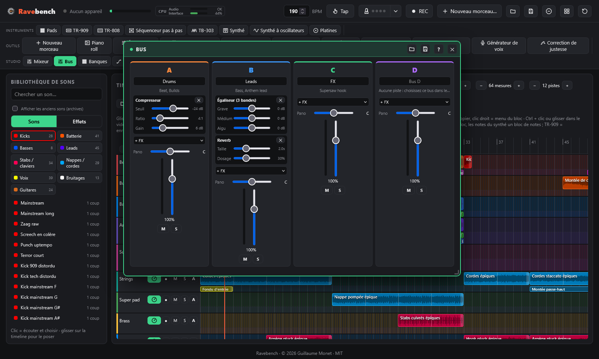

# Mixage et effets

← [Générateur : accords et mélodie](generateur.md) · [Sommaire](README.md) · [Live : platines, scènes, visualiseur](live.md) →

Designer d'effet, table de mixage et sidechain, câblage des boîtes à effets.

## Designer d'effet

Dessinez comment un réglage d'une piste bouge sur **1, 2 ou 4 temps** : la forme se répète en boucle, calée sur le tempo, tant que son bloc dure sur la timeline (une pompe sidechain faite main, un gate trance, un wobble de filtre, un balancier de panoramique…).

- **Réglage piloté** : volume, filtre passe-bas, filtre passe-haut, panoramique, saturation, envoi reverb ou envoi delay.
- **Édition** : clic pour ajouter un point, puis glissez-le (aimanté à la grille : 1/4, 1/8, 1/16, 1/32 et triolets ; **Maj** = libre), double-clic ou clic droit sur un point pour le supprimer. Le **losange** entre deux points courbe le trait (glissez-le vers le haut ou le bas) ; double-clic dessus pour un **palier** : la valeur reste jusqu'au point suivant.
- **Profondeur** ramène la courbe vers « sans effet » (en pointillés), **Lissage** arrondit les paliers pour qu'ils ne claquent jamais. Pour les filtres, la coupure extrême et la résonance.
- **Écouter** joue une boucle de la bibliothèque (batterie, basse, cordes ou hoover) à travers la courbe, avec une tête de lecture : chaque retouche s'entend tout de suite.
- **14 formes de départ** : pompe sidechain, pompe double, gate trance, gate 3-3-2, stutter 1/32, respiration, wobble filtre, dent de scie filtre, balayage passe-haut, ping-pong, balancier, impulsion saturée, queue de reverb, écho à contretemps. Modifiez-en une, puis **Enregistrer dans la bibliothèque** : elle devient votre courbe.
- **Sur la timeline** : vos courbes sont dans la bibliothèque, **Effets › Courbes**. Glissez-en une sur une piste comme un effet de piste, ou cliquez sur **Sur la timeline** (à la tête de lecture, sur la piste du bloc sélectionné). Le bloc montre la forme. Retoucher votre courbe change tous ses blocs d'un coup, même pendant la lecture ; double-clic sur un bloc de courbe pour l'ouvrir dans le designer.
- Vos courbes sont sauvegardées avec le projet, voyagent dans les fichiers morceau et sont dans l'export WAV et les stems.

## Table de mixage

Une voie par outil : **Pads**, **Synthé**, **TR-909**, **Timeline**, **TB-303**, **Platines**, **Synthé à oscillateurs** et **TR-808**, puis le master (effets de performance, égaliseur général et limiteur). Le niveau de chaque son reste dans son outil (volume des pads, niveaux des instruments de la 909) ; la table de mixage équilibre les outils entre eux.

Chaque voie a des effets d'insert (**+ FX**, jusqu'à 4, appliqués dans l'ordre), des envois reverb et delay, un panoramique, un fader (0 dB aux trois quarts), **M**uet, **S**olo et un vumètre. Effets disponibles :
- **Distorsion** : drive et les 5 formes de la 909.
- **Filtre** : passe-bas ou passe-haut, coupure et résonance.
- **Compresseur** : seuil, ratio et gain.
- **Reverb** : taille et dosage.
- **Égaliseur (3 bandes)** : grave, médium et aigu.
- **Multibande (OTT)**, **Écrêteur** et **Stéréo (graves mono)** : les mêmes que dans la chaîne master (voir plus bas), avec les mêmes réglages. Un écrêteur sur le bus ou la piste des kicks donne un kick plus fort sans toucher au reste ; une stéréo à largeur 0 % rend une piste mono.

Double-clic sur un réglage pour le remettre à zéro. Sur l'APC, **Maj + bouton de piste 1 / 2 / 3 / 4** transforme les potentiomètres en volumes / panoramiques / envois delay / envois reverb du mixeur : K1 = Pads, K2 = Synthé, K3 = TR-909, K4 = Timeline, K5 = TB-303, K6 = Platines, K7 = Synthé à oscillateurs, K8 = volume général. Les réglages du mixeur sont sauvegardés et inclus dans les exports de session.

### Sidechain

En haut de la fenêtre de la table de mixage. Quand il est **Activé**, chaque kick fait baisser le **synthé** et le **synthé à oscillateurs** (clavier, blocs de notes et d'accords), la **TB-303** et les **sons mélodiques** (pads et blocs de la timeline des catégories Basses, Leads, Stabs / claviers, Nappes / cordes et Voix), qui remontent ensuite en douceur : le morceau respire avec le kick. Les kicks et la batterie ne sont jamais baissés.

- **Déclenché par** :
  - **Les kicks** : la grosse caisse de la TR-909, les pads et blocs de kick, et les kicks des boucles de Ravebench (leur position exacte est enregistrée dans la bibliothèque : un galop, un roulement ou une montée baisse le son sur chacun de ses kicks). Un enregistrement de la 909 dans la timeline garde aussi la position de ses kicks.
  - **Chaque temps** : sur chaque temps de la grille, pour les boucles dont on ne connaît pas les kicks (boucles Sonic Pi, vos propres boucles).
- **Profondeur** (de combien le son baisse) et **Relâche** (le temps qu'il met à remonter) ; double-clic pour revenir à la valeur par défaut.
- **Baisse** : choisissez le synthé, les sons mélodiques, ou les deux. Le témoin montre la baisse en temps réel.
- La baisse est programmée à l'instant exact de chaque kick (sur l'horloge audio), et non détectée après coup : aucun retard, et elle reste calée à n'importe quel tempo.

### Bus

La fenêtre **Bus** (barre des plugins, groupe Studio) regroupe des pistes de la timeline pour les traiter ensemble : toutes les percussions dans un même compresseur, tous les leads dans une même reverb…

- **Envoyer une piste vers un bus** : dans le panneau de la piste (bouton cadran de son en-tête), choisissez le **Bus** (A à D). La lettre du bus s'affiche dans l'en-tête de la piste, et le bus liste ses pistes.
- Chaque bus a un **nom**, jusqu'à 4 **effets d'insert** (égaliseur, compresseur, distorsion, filtre, reverb, multibande, écrêteur, stéréo), un **panoramique**, un **volume** et un vumètre ; double-clic sur un réglage = valeur par défaut.
- **M** coupe toutes les pistes du bus, **S** le met en solo : on n'entend plus que ses pistes (et les pistes en solo).
- Le son d'un bus continue vers la même destination que celui de ses pistes (synthé, pads, chemin du sidechain…) : mettre une piste dans un bus ne change ni son niveau ni son sidechain, cela ajoute seulement le traitement du bus.
- L'envoi d'une piste vers un bus s'annule avec Ctrl+Z ; les bus sont enregistrés avec le projet et dans les fichiers morceau, et l'export WAV passe par eux.

### Chaîne master et sonie

Sous les voies du mixeur, la **chaîne master** traite tout ce qui sort, dans cet ordre :

- **Stéréo** : met les **graves en mono** et règle la **largeur** du reste. En club, la sono est souvent en mono dans le grave : un kick ou une basse un peu stéréo y perd de la force, et les compresseurs réagissent mieux à un grave identique sur les deux canaux. **Coupé par défaut.**
  - **Mono sous** (20 à 300 Hz, 120 Hz par défaut) : sous cette fréquence, le son devient mono (pente de 24 dB par octave). Au-dessus, l'image stéréo ne bouge pas.
  - **Largeur** (0 à 200 %, 100 % par défaut) : 0 % = tout en mono, 100 % = largeur d'origine, 200 % = élargie. Au-delà de 130 % environ, surveillez la **phase**.
- **Compresseur master** : seuil, taux, coude, attaque, relâche, gain de sortie. Ses réglages de départ sont ceux de l'ancien limiteur de Ravebench : un morceau existant sonne exactement pareil. Baissez le taux (2 à 4) et montez le seuil pour un compresseur de « colle » plus doux.
- **Multibande (façon OTT)** : compression multibande façon OTT, le son « tout est fort et détaillé » du hardcore et du hardstyle. Le son est séparé en trois bandes (sous 88 Hz, de 88 Hz à 2,5 kHz, au-dessus de 2,5 kHz) ; dans chaque bande, ce qui dépasse un seuil est baissé et les passages faibles sous un autre seuil sont remontés (queues, reverbs, détails), puis les bandes traitées sont mélangées aux bandes intactes. **Coupé par défaut.**
  - **Dosage** (0 à 100 %, 30 % à l'activation) : la part du son traité dans le mélange. À 0 %, le son passe intact.
  - **Temps** (×0,10 à ×5) : règle ensemble l'attaque et la relâche des trois bandes (plus court = plus agressif, plus long = plus doux).
  - **Vers le haut** / **Vers le bas** (0 à 100 %) : la part de compression vers le haut et vers le bas. Vers le bas à 0 % = il ne fait que remonter les passages faibles.
  - **Sortie** (−12 à +12 dB) : le niveau après le multibande.
  - Un son très faible (sous environ −70 dB : bruit de fond, silence) n'est jamais remonté.
- **Écrêteur** : rase les crêtes au **plafond**, avant le limiteur. Les crêtes d'un kick sont très courtes : les couper coûte peu à l'oreille et laisse beaucoup moins de travail au limiteur ; le morceau devient plus fort et plus propre qu'en poussant le limiteur seul. L'écrêtage est calculé à 4 fois la fréquence d'échantillonnage (moins de repliement). **Coupé par défaut.**
  - **Gain d'entrée** (0 à +12 dB, +3 dB par défaut) : pousse le son contre le plafond.
  - **Plafond** (−12 à 0 dB, −0,5 dB par défaut) : aucune crête ne va au-delà.
  - **Douceur** (0 à 100 %, 30 % par défaut) : 0 % = écrêtage franc (le plus net sur un kick), 100 % = saturation arrondie qui commence bien sous le plafond.
  - Ordre : le multibande vient avant l'écrêteur (il façonne les bandes, puis l'écrêteur rase ce qui dépasse), et le limiteur, en dernier, ne rattrape plus que ce qui reste.
- **Limiteur** : il anticipe de 5 ms pour qu'**aucun échantillon ne dépasse le plafond** (−0,3 dB par défaut), sans écrêtage. Le **gain d'entrée** pousse le son contre le plafond : c'est le réglage qui rend le morceau plus fort. **Relâche** : la vitesse à laquelle le gain remonte après un pic (plus long = plus doux, plus court = plus fort mais plus « pompé »).
- **Sonie** : la mesure en **LUFS** (norme EBU R128), celle qu'utilisent les plateformes d'écoute. **Momentanée** (400 ms), **court terme** (3 s), **intégrée** (depuis la dernière **remise à zéro**), **crête** et **réduction de gain** du limiteur. La barre montre la sonie court terme ; la zone verte est la cible.
- **Phase** : la corrélation entre les deux canaux. +1 = mono, autour de +0,5 = une stéréo large et saine, 0 = deux canaux sans rapport ; **sous 0 (en rouge)**, des parties du son s'annulent quand on l'écoute en mono (sono de club, téléphone). Baissez alors la largeur ou cherchez l'effet trop large.
- **Cible pour du hardcore** : environ **−8 à −6 LUFS intégrés**, crête au plafond. Montez le gain d'entrée du limiteur jusqu'à la zone, en surveillant la réduction de gain : au-delà de 6 à 8 dB de réduction permanente, le son s'écrase. Pour aller plus loin proprement, activez l'écrêteur (gain d'entrée de 3 à 6 dB) et laissez le limiteur ne rattraper que quelques dB ; ajoutez un peu de multibande (dosage de 20 à 40 %) pour la densité.
- Chaque bouton **Actif / Coupé** contourne son étage ; double-clic sur un réglage = valeur par défaut. La chaîne est enregistrée avec le projet et dans le fichier de réglages du mixeur, et l'**export WAV** passe par elle.

## Câblage

La fenêtre **Câblage** relie librement les outils et des **boîtes à effets**, comme un rack de matériel. Par défaut, chaque outil va directement au master : rien ne change tant que vous n'y touchez pas.

- À gauche, un bloc par **outil** : pads, synthé, TR-909, timeline, TB-303, platines, synthé à oscillateurs, TR-808. Chaque outil garde sa **voie de mixage** (volume, pano, muet, solo, effets d'insert, envois) ; le câblage décide où va cette voie. À droite, le **Master**.
- **Boîtes à effets** : **Distorsion** (drive, les 5 formes de la 909, tonalité, mélange), **PCF** (filtre rythmique LP / BP relancé par un motif de 16 pas, toujours calé sur la grille du tempo), **Filtre** (LP, HP ou BP avec un LFO calé sur le tempo), **Delay** (en valeurs de note : 1/4, 1/8, 1/8 pointée, 1/16, noire de triolet), **Reverb**, **Compresseur**, **Bitcrusher**. Double-clic sur une boîte pour ses réglages, ✕ la retire.
- **Câbler** : tirez depuis une sortie (prise de droite) vers une boîte ou vers le master. Une sortie peut aller à plusieurs endroits, une boîte peut recevoir plusieurs sources, et les boîtes peuvent s'enchaîner. Un câble qui créerait une boucle est refusé. **Clic sur un câble** pour le débrancher. Un outil qui ne va nulle part est muet : le mixeur indique où va chaque voie, sous son nom.
- **Tout sur le master** recâble chaque outil directement sur le master. L'export WAV rapide et les stems reconstruisent exactement le même câblage.

---

← [Générateur : accords et mélodie](generateur.md) · [Sommaire](README.md) · [Live : platines, scènes, visualiseur](live.md) →
